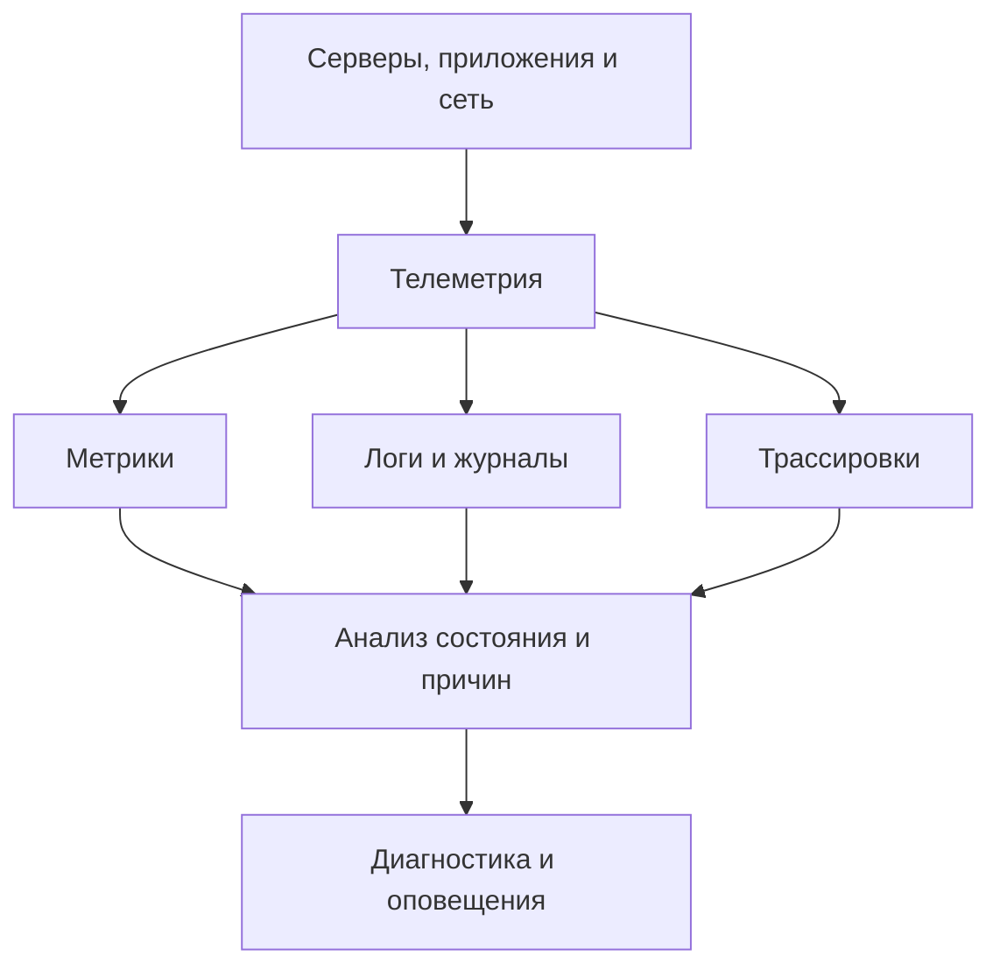
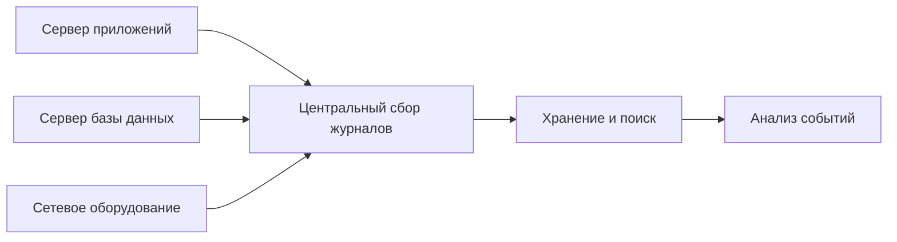
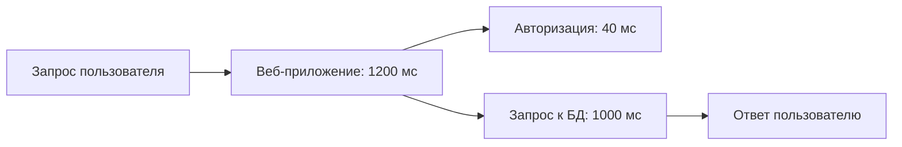
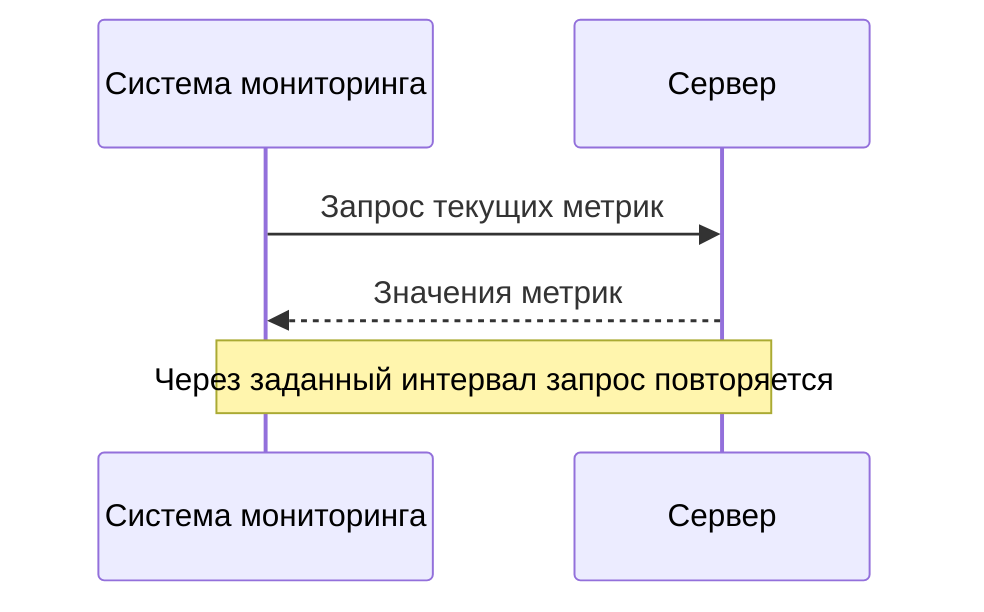
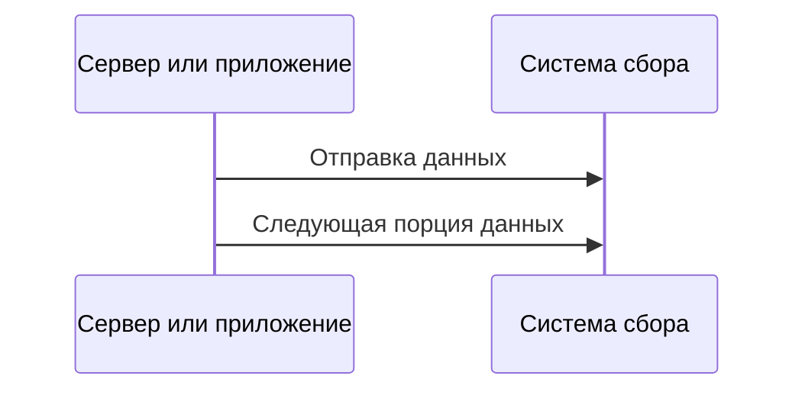
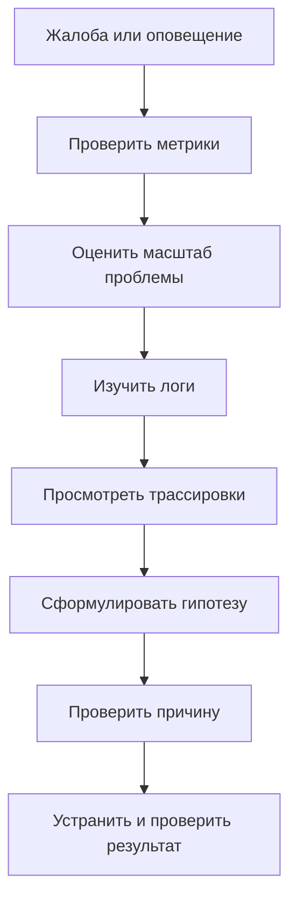

# Мониторинг и логирование: введение в Observability

> [!INFO] Цель лекции
> Понять, как администратор узнаёт о состоянии инфраструктуры, обнаруживает отклонения и выясняет их причины. Разобраться в метриках, логах, журналах, трассировках, моделях Push и Pull, кардинальности, оповещениях и основных принципах наблюдаемости без привязки к конкретным программам.

## 1. Зачем инфраструктуре нужен мониторинг

Представим инфраструктуру колледжа: пользователи входят в домен, открывают учебный портал, работают с файлами и подключаются к сети. Пока всё работает, администратор может не замечать внутренних изменений. Но однажды портал начинает открываться медленно. Причиной может быть перегрузка процессора, нехватка памяти, заполненный диск, ошибка приложения или недоступность базы данных.

Проверять каждый сервер вручную неудобно. Кроме того, проблему важно обнаружить **до того, как на неё массово пожалуются пользователи**. Для этого собирают сведения о работе системы и анализируют их.

**Мониторинг (Monitoring)** — регулярное наблюдение за состоянием системы с помощью измерений, проверок и заранее определённых условий.

Мониторинг помогает ответить на вопросы:

- Работает ли сервер или сервис?
- Сколько ресурсов он использует?
- Укладывается ли время ответа в допустимые пределы?
- Возникло ли отклонение, требующее внимания?

> [!EXAMPLE] Пример
> На сервере учебного портала использование диска выросло с 65 до 92 %. Мониторинг показывает рост и предупреждает администратора до полного заполнения диска.

Однако факт перегрузки ещё не объясняет её причину. Чтобы разобраться, нужны дополнительные сведения о событиях и поведении системы.

## 2. От мониторинга к наблюдаемости

**Наблюдаемость (Observability)** — способность понимать внутреннее состояние системы по данным, которые она выдаёт во время работы.

Мониторинг обычно отвечает на вопрос **«Что происходит и соответствует ли это норме?»**, а наблюдаемость помогает исследовать **«Почему это происходит?»**, в том числе при неожиданной проблеме.

Например, мониторинг сообщает, что время ответа сайта выросло. Анализ данных наблюдаемости позволяет установить, что запросы задерживаются при обращении к базе данных.

> [!IMPORTANT] Главное различие
> Мониторинг — часть наблюдаемости. Наблюдаемость не сводится к красивым графикам: она предполагает, что данные позволяют исследовать причины неизвестных заранее проблем.

Для этого применяют три основных вида телеметрии: **метрики, логи и трассировки**.

**Телеметрия** — данные о состоянии и работе системы, которые собираются для дальнейшего анализа.



## 3. Метрики: измеряем состояние системы

Когда администратор хочет понять, растёт ли нагрузка на сервер, ему нужны не отдельные сообщения, а значения, измеряемые во времени.

**Метрика (Metric)** — числовой показатель, характеризующий состояние или работу системы в определённый момент или за интервал времени.

Примеры метрик:

| Метрика | Что показывает | Единица измерения |
|---|---|---|
| Использование CPU | Долю занятого процессорного времени | % |
| Использование памяти | Объём занятой оперативной памяти | байты, ГиБ |
| Свободное место | Доступный объём диска | байты, ГиБ |
| Сетевой трафик | Скорость передачи данных | бит/с или байт/с |
| Время ответа | Задержку обработки запроса | мс, с |
| Частота ошибок | Количество ошибок за единицу времени | ошибок/с |

Если регулярно измерять показатель, образуется **временной ряд (Time Series)** — последовательность значений метрики с отметками времени.

Например:

| Время | Использование CPU |
|---|---:|
| 10:00 | 18 % |
| 10:05 | 24 % |
| 10:10 | 67 % |
| 10:15 | 93 % |

Отдельное значение 93 % не обязательно означает неисправность. Но последовательный рост в сочетании с увеличением времени ответа уже заслуживает внимания.

### 3.1. Основные типы метрик

**Gauge (измеритель)** — значение, которое может увеличиваться и уменьшаться: температура, объём свободной памяти, число активных соединений.

**Counter (счётчик)** — накопительное значение, которое обычно только увеличивается и может сбрасываться при перезапуске процесса: общее число обработанных запросов или ошибок. Для анализа часто рассчитывают скорость изменения счётчика, например запросов в секунду.

**Histogram (гистограмма)** — распределение измерений по диапазонам значений. Помогает понять, сколько запросов выполнялось быстро, а сколько — медленно.

> [!TIP] Пример с задержкой
> Среднее время ответа 200 мс может скрывать проблему: большинство запросов выполняется за 50 мс, а некоторые — за несколько секунд. Поэтому наряду со средним используют **перцентили**.

**Перцентиль** — значение, ниже которого находится заданная доля измерений. Например, p95 = 800 мс означает, что примерно 95 % измеренных запросов завершились не дольше чем за 800 мс, а около 5 % — дольше.

### 3.2. Метки метрик

Одна метрика может относиться сразу к нескольким серверам и сервисам. Чтобы отличать их, используют **метки (Labels)** — пары «ключ — значение».

Например:

```text
http_requests_total{service="portal", method="GET", status="200"}
http_requests_total{service="portal", method="POST", status="500"}
```

Здесь имя метрики одно, но наборы меток разные. Каждый уникальный набор меток образует отдельный временной ряд.

Метки позволяют сравнивать сервисы, методы запросов и коды ответа, но чрезмерное количество уникальных значений создаёт новую проблему — высокую кардинальность. К ней вернёмся в разделе 7.

## 4. Логи и журналы: восстанавливаем последовательность событий

Метрика показывает, что количество ошибок выросло. Но из одного числа обычно невозможно узнать, какие именно ошибки произошли. Поэтому системы записывают события.

**Лог (Log Record)** — отдельная запись о событии, произошедшем в системе или приложении.

**Журнал (Log / Journal)** — упорядоченная совокупность таких записей, обычно сохраняемая в файле, базе данных или специализированном хранилище.

В администрировании слова «лог» и «журнал» часто употребляются как синонимы. При этом полезно различать **запись о событии** и **набор записей**.

Пример:

```text
2026-11-17T10:15:03Z INFO  User login succeeded user=student01
2026-11-17T10:15:08Z WARN  Database response slow duration_ms=1800
2026-11-17T10:15:09Z ERROR Request failed status=500 request_id=abc123
```

Типичная запись содержит время, источник, уровень важности, описание события и дополнительные поля.

### 4.1. Уровни логирования

| Уровень | Назначение |
|---|---|
| DEBUG | Подробности для диагностики |
| INFO | Обычные события работы |
| WARN / WARNING | Подозрительная ситуация или предупреждение |
| ERROR | Ошибка отдельной операции |
| FATAL / CRITICAL | Критический сбой, который может остановить компонент |

Конкретные названия и смысл уровней зависят от приложения.

> [!WARNING] Важное замечание
> Большое количество записей `ERROR` не всегда означает полный отказ сервиса, а отсутствие ошибок в журнале не гарантирует исправность системы.

### 4.2. Структурированные и неструктурированные логи

**Неструктурированный лог** — преимущественно текстовое сообщение, которое человеку удобно читать, но программе бывает трудно однозначно разобрать.

```text
User student01 failed to login from 10.1.2.3
```

**Структурированный лог** — запись с явно выделенными полями, например в JSON:

```json
{
  "timestamp": "2026-11-17T10:20:00Z",
  "level": "WARN",
  "event": "login_failed",
  "user": "student01",
  "source_ip": "10.1.2.3"
}
```

Структурированные записи проще фильтровать, группировать и сопоставлять между разными системами.

### 4.3. Централизованное логирование

Если журналы находятся только на отдельных серверах, при расследовании приходится заходить на каждый из них. Поэтому записи часто отправляют в общее хранилище.

**Централизованное логирование** — сбор журналов из нескольких источников в единую систему для хранения, поиска и анализа.



> [!DANGER] Безопасность журналов
> В логах могут оказаться IP-адреса, имена пользователей и другие чувствительные сведения. Не следует записывать пароли, токены доступа и секретные ключи. Доступ к журналам и сроки их хранения необходимо ограничивать.

## 5. Трассировки: прослеживаем путь запроса

Современный сервис редко выполняет всю работу самостоятельно. Например, пользователь открывает портал, портал обращается к сервису авторизации, затем к базе данных.

**Распределённая трассировка (Distributed Tracing)** — способ проследить обработку одного запроса через несколько компонентов системы.

**Trace (трасса)** — полный путь обработки запроса. **Span (операция, участок трассы)** — отдельный этап этого пути со своим временем начала, продолжительностью и дополнительными данными.



В примере основная задержка связана с базой данных. В реальной трассе операции могут быть вложенными и выполняться параллельно, поэтому их длительности нельзя всегда просто складывать.

Для связи событий одного запроса часто используют **Trace ID**, а для отдельных операций — **Span ID**. Идентификатор запроса также может записываться в логи, чтобы связать записи с трассировкой.

> [!INFO] Как дополняют друг друга три вида данных
> **Метрики** показывают масштаб проблемы, **логи** описывают конкретные события, а **трассировки** помогают определить, на каком этапе обработки запроса возникла задержка или ошибка.

## 6. Как телеметрия попадает в систему наблюдения: Push и Pull

Мы разобрали, какие данные собирают. Теперь нужно понять, **как они передаются** от источника к системе сбора.

### 6.1. Модель Pull

**Pull (опрос)** — модель, при которой система сбора сама периодически запрашивает данные у источника.



Преимущества: централизованное управление периодичностью опроса; возможность заметить, что источник перестал отвечать.

Ограничения: система сбора должна иметь сетевой доступ к источнику; кратковременные изменения между опросами могут быть пропущены.

### 6.2. Модель Push

**Push (отправка)** — модель, при которой источник сам передаёт данные получателю.



Преимущества: удобно для событий, журналов и краткоживущих задач; источник может самостоятельно инициировать передачу.

Ограничения: необходимо контролировать потерю данных, повторные отправки, очереди и доступность получателя. Если отправка прекращается, это не всегда сразу означает неисправность источника.

| Критерий | Pull | Push |
|---|---|---|
| Кто начинает передачу | Система сбора | Источник |
| Типичный сценарий | Периодический опрос метрик | Передача событий, логов, телеметрии |
| Доступность источника | Система сбора должна обратиться к источнику | Источник должен обратиться к получателю |
| Контроль периодичности | Обычно на стороне сборщика | Обычно на стороне отправителя |

> [!TIP] Важно
> Push и Pull — не «хорошая» и «плохая» модели. В одной инфраструктуре они могут применяться одновременно. Способ доставки данных не определяет автоматически их тип.

### 6.3. Интервал сбора и задержка данных

**Интервал сбора (Scrape / Collection Interval)** — периодичность получения измерений. Например, каждые 15 или 60 секунд.

**Задержка поступления (Ingestion Delay)** — время между возникновением события и его доступностью для анализа.

Частый сбор повышает детализацию, но увеличивает объём данных и нагрузку. Редкий сбор экономит ресурсы, но может скрыть короткие скачки.

## 7. Кардинальность: почему меток не должно быть слишком много

Предположим, мы измеряем количество HTTP-запросов и добавляем метки `service`, `method` и `status`. Каждая уникальная комбинация значений создаёт отдельный временной ряд.

**Кардинальность (Cardinality)** — количество уникальных комбинаций значений меток, а значит, отдельных временных рядов для данной метрики.

Если имеются 5 сервисов, 3 метода и 4 варианта статуса, максимальное число комбинаций составляет:

\[
5 \times 3 \times 4 = 60
\]

Если дополнительно добавить метку `user_id` с 10 000 уникальных пользователей, потенциальное количество рядов вырастет до:

\[
5 \times 3 \times 4 \times 10\,000 = 600\,000
\]

Фактическое число рядов может быть меньше: не все комбинации обязательно существуют.

> [!DANGER] Высокая кардинальность
> Уникальные идентификаторы пользователей, запросов, сессий и случайные значения обычно не подходят для меток метрик: они могут резко увеличить расход памяти, объём хранения и стоимость обработки.

**Практическое правило:** в метках метрик оставляют ограниченный набор повторяющихся значений (например, сервис, окружение, код ответа), а уникальные идентификаторы конкретных событий помещают в логи и трассировки.

Не следует путать **кардинальность** (число уникальных рядов) с **частотой сбора** (сколько измерений записывается за время). Оба фактора влияют на объём хранимых данных.

## 8. От данных к оповещениям

Данные полезны, только если по ним можно принять решение. Для этого определяют, какие изменения считаются опасными.

**Порог (Threshold)** — заранее заданное значение показателя, при превышении или снижении которого система может считать ситуацию отклонением.

**Правило оповещения (Alert Rule)** — условие, по которому формируется сигнал о возможной проблеме.

**Оповещение (Alert)** — сообщение о выполнении такого условия.

Например: свободное место на диске меньше 10 % в течение 10 минут.

Почему не всегда достаточно одного мгновенного измерения? Кратковременные скачки нагрузки бывают нормальными. Если реагировать на каждый, возникнет **шум оповещений (Alert Noise)** — поток малополезных сообщений.

**Усталость от оповещений (Alert Fatigue)** — ситуация, когда из-за большого количества уведомлений администратор начинает пропускать действительно важные сигналы.

> [!WARNING] Пример плохого правила
> «CPU больше 80 % хотя бы один раз» может срабатывать при нормальной кратковременной нагрузке.
>
> Более осмысленное правило учитывает длительность отклонения, контекст и влияние на пользователей.

Полезно различать:

- **Симптом:** пользователи долго ждут загрузки страницы.
- **Причина:** база данных выполняет запросы медленно.
- **Последствие:** часть операций завершается ошибкой.

Оповещение должно помогать обнаружить значимую проблему, а не просто сообщать о любом изменении числа.

## 9. Доступность, производительность и надёжность

Наблюдаемость нужна не только для поиска ошибок, но и для оценки качества сервиса.

**Доступность (Availability)** — доля времени или запросов, в течение которых сервис доступен согласно выбранному критерию.

**Задержка (Latency)** — время выполнения операции или ответа на запрос.

**Пропускная способность (Throughput)** — количество операций или объём данных, обрабатываемых за единицу времени.

**Частота ошибок (Error Rate)** — доля или количество операций, завершившихся ошибкой, за определённый период.

Например, учебный портал может быть доступен, но отвечать настолько медленно, что работать с ним практически невозможно. Поэтому одного показателя доступности недостаточно.

### 9.1. SLI, SLO и SLA

**SLI (Service Level Indicator)** — измеримый показатель качества сервиса, например доля успешных HTTP-запросов.

**SLO (Service Level Objective)** — целевое значение SLI, например не менее 99,9 % успешных запросов за месяц.

**SLA (Service Level Agreement)** — соглашение об уровне сервиса, определяющее обязательства сторон и возможные последствия их нарушения.

> [!EXAMPLE] Пример
> SLI: процент успешных запросов к порталу. SLO: не менее 99,9 % за месяц. SLA: договорное обязательство поддерживать определённый уровень качества, если такое соглашение существует.

**Бюджет ошибок (Error Budget)** — допустимый объём несоответствия целевому уровню SLO за период. При SLO 99,9 % допускается 0,1 % неуспешных запросов в выбранном окне измерения.

## 10. Хранение данных и их качество

Телеметрия может поступать постоянно и быстро занимать большой объём хранилища. Поэтому заранее решают, сколько данных необходимо сохранять.

**Retention (срок хранения)** — период, в течение которого собранные данные остаются доступными.

**Агрегация (Aggregation)** — объединение нескольких измерений в итоговое значение: среднее, максимум, сумму или количество.

**Понижение детализации (Downsampling)** — сохранение менее подробных данных за старые периоды, например переход от значений за каждую минуту к часовым агрегатам.

При агрегации часть деталей теряется: среднее значение за час может скрыть короткую перегрузку.

Не менее важны качество данных и согласованность времени:

- Источники должны использовать синхронизированное время, иначе трудно восстановить порядок событий.
- У каждой метрики должны быть понятные единицы измерения.
- У записей должен быть определён источник.
- Отсутствие данных нельзя автоматически считать нулевым значением.
- Дублирование или потеря событий могут исказить результаты анализа.

> [!INFO] Ещё один важный принцип
> Наблюдаемость требует не только сбора, но и правильной интерпретации данных. Неверные часы на серверах могут создать ложную картину последовательности событий.

## 11. Как администратор расследует проблему

Рассмотрим ситуацию: преподаватели сообщают, что учебный портал работает медленно.

**Шаг 1. Проверить симптомы.** Измерения показывают, что p95 времени ответа увеличился с 300 мс до 2 секунд.

**Шаг 2. Оценить масштаб.** Метки позволяют выяснить, что проблема касается только портала, а остальные сервисы работают нормально.

**Шаг 3. Изучить события.** В журналах приложения появились предупреждения о медленных запросах к базе данных.

**Шаг 4. Проследить запрос.** Трассировка показывает, что основная часть времени уходит на операцию с базой данных.

**Шаг 5. Сопоставить данные.** Метрики сервера базы данных показывают рост нагрузки и задержек дисковых операций.

**Шаг 6. Проверить гипотезу.** Администратор выясняет, какое изменение или процесс вызвали нагрузку, устраняет причину и убеждается, что показатели вернулись к норме.



> [!TIP] Основная идея
> Ни один источник данных не гарантирует полного ответа. Чем лучше метрики, журналы и трассировки связаны между собой, тем быстрее можно перейти от обнаружения симптома к проверке причины.

## Вопросы для самопроверки

1. Для чего нужен мониторинг инфраструктуры?
2. Чем наблюдаемость отличается от обычного мониторинга?
3. Что такое телеметрия и какие три основных вида данных выделяют?
4. Чем метрика отличается от записи в журнале?
5. Что такое временной ряд и зачем метрикам нужны метки?
6. Чем Counter отличается от Gauge?
7. Почему среднее время ответа не всегда отражает опыт пользователей?
8. Что такое структурированный лог и чем он удобен?
9. Для чего нужны Trace и Span?
10. Кто инициирует передачу данных в моделях Push и Pull?
11. Что такое кардинальность и почему `user_id` опасен как метка метрики?
12. Чем порог отличается от правила оповещения?
13. Почему возникает усталость от оповещений?
14. В чём различие между SLI, SLO и SLA?
15. Зачем нужны сроки хранения и агрегация телеметрии?

## Итоги — что было разобрано

- Мониторинг позволяет отслеживать состояние системы и обнаруживать отклонения.
- Наблюдаемость помогает исследовать причины проблем по данным, которые выдаёт система.
- Метрики показывают числовые изменения, логи фиксируют события, трассировки связывают этапы обработки запроса.
- Push и Pull описывают разные способы передачи телеметрии.
- Метки повышают полезность метрик, но высокая кардинальность увеличивает затраты на их обработку и хранение.
- Оповещения требуют осмысленных условий, иначе возникает информационный шум.
- Качество сервиса оценивают по доступности, задержкам, ошибкам и целевым показателям.
- При расследовании проблем важно сопоставлять несколько источников данных.

## Связанные заметки

> [!NOTE]
> Ссылки на другие заметки можно добавить после проверки их точных путей в базе Obsidian.

---

## Теги

#observability #monitoring #logging #metrics #logs #tracing #telemetry #push #pull #cardinality #alerting #sli #slo #sla #devops #системное_администрирование
