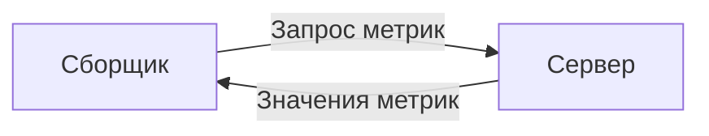
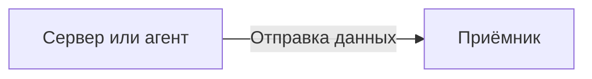

## 1. Зачем наблюдать за инфраструктурой

Представим учебный портал. Утром он открывается быстро, а к началу занятий страницы начинают загружаться по 20 секунд. Сервер включён, сеть доступна, но работать невозможно.

Обычная проверка «сервер отвечает?» покажет, что всё нормально. Однако администратору нужно выяснить:

1. **Есть ли проблема?** — портал отвечает слишком медленно.
2. **Где проблема?** — сеть, веб-сервер, приложение или база данных?
3. **Когда она началась?** — после обновления или при увеличении числа пользователей?
4. **Почему она возникла?** — закончилась память, выросло число запросов или появились ошибки?

Для ответа на эти вопросы собирают и анализируют данные о работе системы.

**Мониторинг (Monitoring)** — регулярное наблюдение за состоянием системы по выбранным показателям и условиям.

**Логирование (Logging)** — запись событий, происходящих в системе, для последующего анализа.

> [!EXAMPLE] Пример
> Мониторинг сообщает: «Время ответа портала выросло до 5 секунд». Логи помогают уточнить: «Запрос к базе данных завершился ошибкой подключения».

## 2. От мониторинга к наблюдаемости

Если заранее известно, что проверять, достаточно мониторинга: доступен ли сервер, сколько свободного места на диске, не превышена ли нагрузка.

Но некоторые сбои невозможно предсказать. Тогда нужно не просто увидеть тревожный показатель, а **исследовать поведение системы**.

**Наблюдаемость (Observability)** — способность понимать внутреннее состояние системы по данным, которые она создаёт во время работы.

Разница в вопросах:

| Мониторинг | Наблюдаемость |
|---|---|
| «Работает ли сервис?» | «Почему сервис работает неправильно?» |
| «Превышен ли порог нагрузки?» | «Что вызвало рост нагрузки?» |
| «Сколько ошибок за минуту?» | «Какие запросы приводят к ошибкам?» |

> [!IMPORTANT] Главное
> Мониторинг — **часть** наблюдаемости. Observability не заменяет мониторинг, а позволяет глубже исследовать причины проблем.

Данные наблюдаемости часто делят на три группы: **метрики, логи и трассировки**. Они дополняют друг друга.

## 3. Метрики: что происходит в цифрах

**Метрика (Metric)** — числовой показатель состояния или работы системы, измеряемый во времени.

Например, у портала можно измерять:

- загрузку процессора — 85 %;
- использование оперативной памяти — 6,2 ГБ;
- число запросов — 120 в секунду;
- долю ошибочных запросов — 4 %;
- время ответа — 0,8 секунды.

Отдельное число полезно, но **история измерений** важнее: она показывает рост, падение и необычные изменения.

### 3.1. Основные типы метрик

| Тип | Что показывает | Пример |
|---|---|---|
| **Gauge** (измеряемое значение) | Значение, которое растёт и уменьшается | Текущая температура, занятая память |
| **Counter** (счётчик) | Накопленное число событий | Всего обработано 15 000 запросов |
| **Histogram** (гистограмма) | Распределение измерений по диапазонам | Сколько запросов выполнилось быстрее 100 мс, 500 мс и т. д. |

> [!TIP] Не путайте счётчик и скорость
> Counter показывает **общее количество** запросов с момента запуска. Чтобы узнать **запросы в секунду**, вычисляют изменение счётчика за интервал времени.

### 3.2. Среднее значение не всегда отражает проблему

Допустим, девять запросов выполнились за 100 мс, а один — за 5 секунд. Среднее время составит 590 мс, хотя один пользователь ждал очень долго.

**Перцентиль** показывает значение, ниже которого находится заданная доля измерений. Например, **p95 = 800 мс** означает, что примерно 95 % запросов выполнялись не дольше 800 мс.

Поэтому для оценки задержек полезно смотреть не только среднее, но и p95/p99.

### 3.3. Четыре полезных сигнала сервиса

Для веб-сервиса удобно наблюдать:

1. **Latency** — задержка ответа.
2. **Traffic** — объём нагрузки, например запросы в секунду.
3. **Errors** — частота или доля ошибок.
4. **Saturation** — близость ресурса к пределу возможностей.

> [!INFO] Пример связи показателей
> Число запросов выросло → база данных приблизилась к пределу нагрузки → задержка увеличилась → появились ошибки. Одна метрика не объяснит всю цепочку.

## 4. События, журналы и логи: что именно произошло

Метрики показывают общую картину, но не всегда объясняют конкретное событие.

**Событие (Event)** — значимое действие или изменение состояния: вход пользователя, запуск службы, ошибка подключения, изменение конфигурации.

**Лог (Log record)** — отдельная запись об этом событии.

**Журнал (Log / Journal)** — упорядоченный набор таких записей, обычно с указанием времени.

> [!EXAMPLE] Условная запись журнала
> `2026-11-17 09:15:32 ERROR portal: database connection timeout`
>
> Здесь указаны время, уровень важности, источник и описание ошибки.

### 4.1. Уровни событий

| Уровень | Смысл | Пример |
|---|---|---|
| DEBUG | Подробности для диагностики | Этап обработки запроса |
| INFO | Обычная работа | Служба запущена |
| WARN / WARNING | Возможная проблема | Мало свободного места |
| ERROR | Операция завершилась ошибкой | Не удалось подключиться к БД |
| CRITICAL / FATAL | Серьёзный сбой | Сервис не может продолжить работу |

Названия и точное поведение уровней зависят от приложения.

### 4.2. Структурированные и неструктурированные логи

**Неструктурированная запись** — свободный текст:

`User 42 failed to login from 192.0.2.10`

**Структурированная запись** — данные в отдельных полях:

```json
{"time":"2026-11-17T09:15:32Z","level":"WARN","event":"login_failed","user_id":"42","source_ip":"192.0.2.10"}
```

Структурированные логи проще фильтровать, группировать и сопоставлять с другими событиями.

> [!DANGER] Безопасность логирования
> В журналы нельзя без необходимости записывать пароли, токены доступа, секретные ключи и персональные данные. Доступ к журналам и срок их хранения должны контролироваться.

### 4.3. Логи и аудит — не одно и то же

**Диагностические логи** помогают искать ошибки и анализировать работу программ.

**Журналы аудита** фиксируют значимые с точки зрения безопасности действия: кто вошёл в систему, что изменил, к каким ресурсам обратился.

Одна система может создавать оба вида записей, но цели и требования к их хранению отличаются.

## 5. Трассировки: как прошёл один запрос

Современный сервис может состоять из нескольких компонентов: веб-сервера, приложения, базы данных и внешнего API. Пользователь видит одну страницу, но её загрузка вызывает целую цепочку операций.

**Трассировка (Trace)** — представление пути одного запроса через компоненты системы.

**Span** — отдельная операция внутри трассировки, например обращение к базе данных. У span обычно есть время начала, длительность и контекст выполнения.


В этом примере трассировка позволяет предположить, что основная задержка связана с обращением к базе данных.

> [!TIP] Три источника — три вопроса
> **Метрики:** «Насколько часто и сильно?»  
> **Логи:** «Что конкретно произошло?»  
> **Трассировки:** «Где в цепочке операций возникла задержка или ошибка?»

## 6. Как данные попадают в систему наблюдения

Измерения и события нужно не только создать, но и **доставить, сохранить и сделать доступными для анализа**.


**Источник данных** — сервер, приложение или сетевое устройство, которое создаёт измерения и события.

**Агент** — компонент, который собирает или пересылает данные от источника. Иногда приложение отдаёт данные самостоятельно, без отдельного агента.

**Экспортёр** — компонент, предоставляющий показатели системы в формате, пригодном для сбора.

### 6.1. Pull: система сама забирает данные

При модели **Pull** центральный сборщик периодически обращается к источнику и получает новые значения.



Преимущества: сборщик управляет частотой опроса и может замечать недоступность источника. Ограничение: источник должен быть доступен сборщику по сети.

### 6.2. Push: источник отправляет данные

При модели **Push** источник или агент самостоятельно отправляет данные получателю.



Преимущества: удобно передавать события сразу после возникновения и работать с кратковременными задачами. Ограничение: при недоступности приёмника необходимо продумать буферизацию, повторную отправку и защиту от потери данных.

| Вопрос | Pull | Push |
|---|---|---|
| Кто инициирует передачу? | Сборщик | Источник или агент |
| Типичный сценарий | Периодический опрос метрик | Передача событий, логов или метрик |
| Что важно учитывать? | Доступность источника | Очередь, повторы, потери |

> [!IMPORTANT] Не привязывайте модели к типу данных
> Метрики могут передаваться и Push, и Pull. Логи также могут собираться разными способами. Выбор зависит от архитектуры и требований.

### 6.3. Интервал сбора и задержка данных

**Интервал сбора** — как часто получают очередное измерение. Например, каждые 15 или 60 секунд.

Малый интервал позволяет быстрее замечать изменения, но увеличивает объём данных и нагрузку. Большой интервал экономит ресурсы, но может скрыть короткий всплеск.

Также различают **время события** (когда оно произошло) и **время получения** (когда запись поступила в хранилище). Эти моменты могут не совпадать.

## 7. Метки и кардинальность: почему количество данных быстро растёт

Представим метрику `http_requests_total` — общее число HTTP-запросов. Одного значения мало: нужно понимать, к какому сервису и какому результату оно относится.

**Метка (Label / Tag)** — дополнительный признак метрики, представленный парой «ключ — значение».

Пример:

`http_requests_total{service="portal",method="GET",status="200"}`

Здесь метки позволяют отдельно анализировать запросы разных сервисов, методов и статусов.

**Временной ряд (Time series)** — последовательность значений одной метрики с конкретным набором меток во времени.

### 7.1. Что такое кардинальность

**Кардинальность (Cardinality)** — количество уникальных комбинаций значений меток, а значит, отдельных временных рядов для метрики.

Допустим, метрика содержит:

- 5 сервисов;
- 3 метода запроса;
- 4 кода ответа.

Максимально возможное число комбинаций при наличии всех сочетаний:

**5 × 3 × 4 = 60 временных рядов.**

Если добавить метку `user_id` с 10 000 значений, теоретический максимум вырастет до **600 000 рядов**.

> [!DANGER] Высокая кардинальность
> Метки с большим числом уникальных значений — например `user_id`, `request_id`, полный URL с параметрами — могут резко увеличить потребление памяти, диска и стоимость обработки метрик.

**Практическое правило:** в метриках используйте ограниченный набор полезных категорий (сервис, метод, статус). Уникальные идентификаторы конкретных запросов чаще уместнее в логах и трассировках.

## 8. Хранение и качество данных

Чем больше серверов и приложений, тем больше собирается информации. Поэтому необходимо определить, **что хранить, как долго и с какой подробностью**.

**Retention (срок хранения)** — период, в течение которого данные остаются доступными. Например, подробные метрики могут храниться 30 дней, а агрегированные — дольше.

**Агрегация** — объединение измерений для получения обобщённого показателя: среднего, суммы, максимума и т. п.

**Downsampling (снижение детализации)** — замена частых измерений более редкими агрегированными значениями при длительном хранении.

> [!EXAMPLE] Пример
> За сутки измерения каждую минуту дают 1 440 точек на один ряд. При сохранении одного агрегированного значения за час останется 24 точки. Деталей меньше, но общую тенденцию увидеть можно.

Важно учитывать также пропуски измерений, неправильное время на устройствах и повторную доставку событий. Отсутствие данных **не равно нулевому значению**.

## 9. Дашборды, оповещения и реакция

Собранные данные полезны, только если по ним можно принять решение.

**Дашборд (Dashboard)** — экран с графиками и показателями, отражающими состояние системы.

**Алерт (Alert)** — уведомление о выполнении условия, указывающего на возможную проблему.

Например: «Доля ошибок HTTP превышает 5 % в течение пяти минут».

Важно различать:

- **Симптом** — портал отвечает медленно.
- **Причину** — база данных исчерпала доступные соединения.
- **Последствие** — студенты не могут открыть задания.

> [!WARNING] Не каждый всплеск требует тревоги
> Если отправлять оповещение на каждое кратковременное изменение, возникает **alert fatigue** — усталость от уведомлений. Важны длительность условия, влияние на пользователей и приоритет события.

**SLI (Service Level Indicator)** — измеримый показатель качества сервиса, например доля успешных запросов.

**SLO (Service Level Objective)** — целевое значение такого показателя, например не менее 99,9 % успешных запросов за месяц.

Эти понятия помогают оценивать сервис с точки зрения пользователя, а не только по загрузке оборудования.

## 10. Разбор ситуации: почему тормозит учебный портал

Вернёмся к примеру из начала лекции.

1. **Мониторинг** обнаруживает рост времени ответа и доли ошибок.
2. **Метрики** показывают, что нагрузка на процессор умеренная, но число активных соединений с базой данных достигло предела.
3. **Трассировка** выявляет, что большая часть времени запроса уходит на ожидание ответа базы данных.
4. **Логи** содержат сообщения о превышении времени ожидания соединения.
5. **Администратор** проверяет изменения конфигурации и нагрузку, устанавливает причину и устраняет её.
6. **После исправления** показатели сравнивают с нормальными значениями, чтобы убедиться в восстановлении работы.

> [!SUCCESS] Вывод
> Метрики обнаружили отклонение, трассировка указала проблемный участок, логи дали детали. Вместе эти данные помогли перейти от симптома к причине.

## Вопросы для самопроверки

1. Чем мониторинг отличается от наблюдаемости?
2. Какие вопросы помогают решать метрики, логи и трассировки?
3. Чем Counter отличается от Gauge?
4. Почему среднего времени ответа иногда недостаточно?
5. Что такое событие, запись лога и журнал?
6. Чем диагностические логи отличаются от журналов аудита?
7. Кто инициирует передачу данных в моделях Push и Pull?
8. Что такое метка и временной ряд?
9. Почему метка `user_id` может быть опасна для хранения метрик?
10. Чем SLI отличается от SLO и для чего нужны алерты?

## Итоги — что было разобрано

- **Мониторинг** обнаруживает отклонения, а **Observability** помогает исследовать причины.
- **Метрики** показывают динамику числовых показателей, **логи** фиксируют события, **трассировки** раскрывают путь запроса.
- **Push и Pull** определяют, кто инициирует передачу данных.
- **Метки** делают метрики полезнее, но высокая **кардинальность** увеличивает затраты ресурсов.
- **Хранение, дашборды, алерты и SLO** превращают данные в инструмент поддержки качества сервиса.

## Связанные заметки

> [!INFO] Навигация по базе знаний
> Ссылки на другие заметки не добавлены: их точные пути и имена необходимо проверить по актуальной структуре хранилища Obsidian.

---

## Теги

#observability #monitoring #logging #metrics #logs #tracing #push #pull #cardinality #devops #администрирование #мониторинг #логирование
