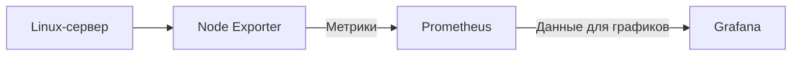
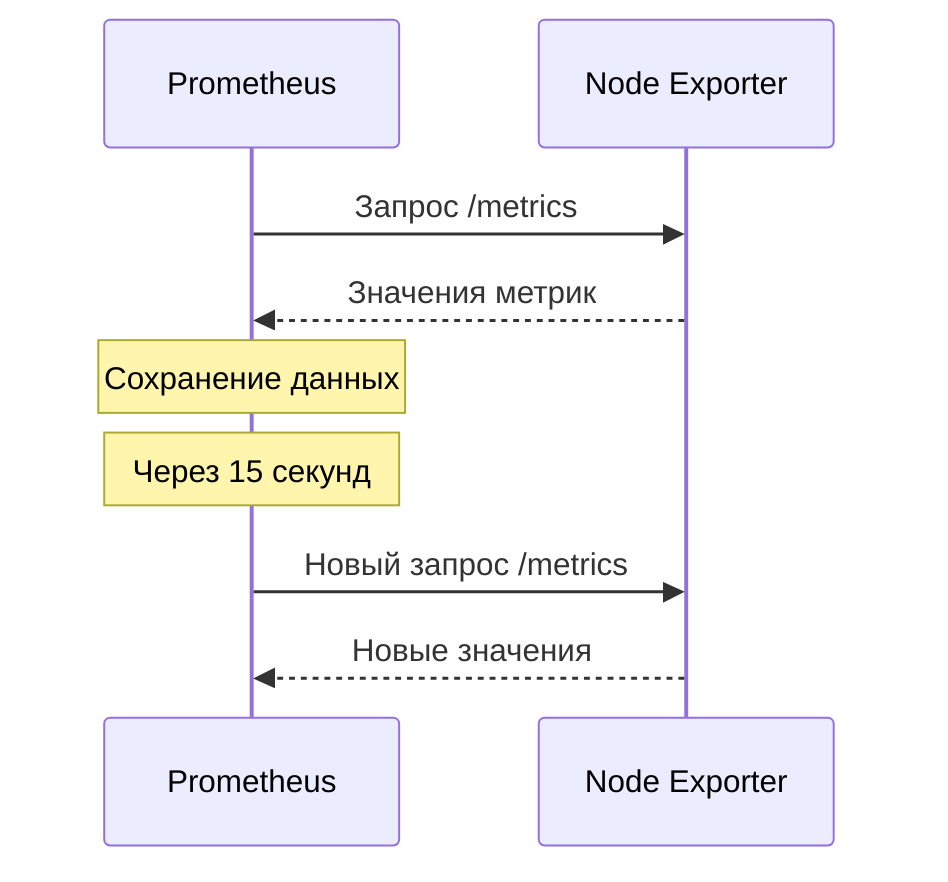

## 1. Для чего нужен Prometheus

Чтобы следить за работой сервера, нужно регулярно измерять загрузку процессора, использование памяти, количество запросов и другие показатели.

<mark style="background:#fff88f">**Prometheus** — система мониторинга, которая собирает числовые показатели (**метрики**), сохраняет их и позволяет смотреть, как они изменялись со временем. Система работает по модели pull.</mark>

Например, с помощью Prometheus можно узнать, сколько памяти было занято час назад или когда сервер перестал отвечать на запросы мониторинга.

> [!INFO] Роль Prometheus-а
> <mark style="background:#fff88f">Prometheus предназначен прежде всего для **метрик**, а не для хранения текстовых журналов событий (логов).</mark>

## 2. Как устроен мониторинг

Рассмотрим Linux-сервер, за состоянием которого нужно наблюдать.

<mark style="background:#fff88f">**Exporter (экспортёр)** — программа, которая предоставляет метрики системы или приложения.</mark>

<mark style="background:#fff88f">**Node Exporter** — экспортёр для Linux, предоставляющий показатели процессора, памяти, дисков и сети.</mark>



1. Node Exporter предоставляет показатели сервера.
2. Prometheus регулярно запрашивает их и сохраняет.
3. Grafana запрашивает данные из Prometheus и строит графики.

## 3. Как собираются метрики

<mark style="background:#fff88f">Prometheus обычно использует модель **Pull**: он сам обращается к источникам за метриками.</mark>

<mark style="background:#fff88f">**Scrape** — один сбор метрик с источника.</mark>

<mark style="background:#fff88f">**Scrape interval** — промежуток между сборами, например 15 секунд.</mark>

<mark style="background:#fff88f">**Endpoint** — адрес, по которому источник предоставляет метрики. Часто используется путь `/metrics`.</mark>

Пример адреса Node Exporter:

```text
http://192.168.1.10:9100/metrics
```

Здесь `192.168.1.10` — IP-адрес сервера, `9100` — порт, `/metrics` — путь.



## 4. Что такое Target и Job

Prometheus нужно знать адреса источников, к которым обращаться.

<mark style="background:#fff88f">**Target** — один конкретный источник метрик, например `192.168.1.10:9100`.</mark>

<mark style="background:#fff88f">**Job** — группа источников, объединённых общим назначением, например `linux-servers`.</mark>

| Job             | Target              |
| --------------- | ------------------- |
| `linux-servers` | `192.168.1.10:9100` |
| `linux-servers` | `192.168.1.11:9100` |

В этом примере один Job объединяет два Target.

### Состояние источника

<mark style="background:#fff88f">После сбора Prometheus показывает состояние **Target**:</mark>

- <mark style="background:#fff88f">**UP** — метрики удалось получить;</mark>
- <mark style="background:#fff88f">**DOWN** — получить метрики не удалось.</mark>

<mark style="background:#fff88f">Метрика `up` принимает значение `1` при успешном сборе и `0` при неуспешном.</mark>

## 5. Как выглядят метрики

<mark style="background:#fff88f">Метрика имеет имя и числовое значение:</mark>

```text
http_requests_total 120
```

<mark style="background:#fff88f">Это счётчик запросов со значением 120.</mark>

<mark style="background:#fff88f">**Метки (Labels)** помогают разделить данные на группы:</mark>

```text
http_requests_total{status="success"} 100
http_requests_total{status="error"} 20
```

<mark style="background:#fff88f">Здесь отдельно учитываются успешные запросы и ошибки.</mark>

### Типы метрик

| Тип | Что показывает | Пример |
|---|---|---|
| **Counter** | Счётчик событий, который обычно растёт | Число запросов |
| **Gauge** | Значение, которое может расти и уменьшаться | Занятая память |
| **Histogram** | Распределение измерений по диапазонам | Время обработки запросов |

> [!INFO] Особенность Counter
> После перезапуска программы счётчик может сброситься. Поэтому его скорость роста рассчитывают специальными запросами.

## 6. Как хранятся метрики

Prometheus записывает значения вместе со временем измерения.

**Временной ряд (Time Series)** — последовательность значений одной метрики с определённым набором меток, записанных в разные моменты времени.

| Время | Занятая память |
|---|---|
| 10:00 | 2 ГБ |
| 10:01 | 2,2 ГБ |
| 10:02 | 2,1 ГБ |

<mark style="background:#fff88f">**TSDB (Time Series Database)** — база данных для хранения временных рядов. Prometheus использует собственную TSDB.</mark>

<mark style="background:#fff88f">**Retention** — срок хранения данных. Старые данные удаляются в соответствии с настройками хранения.</mark>

> [!TIP] Почему это важно?
> <mark style="background:#fff88f">Метрики поступают постоянно. Ограничение срока хранения помогает контролировать занятое место на диске.</mark>

### Метки и кардинальность

Если метка `status` имеет два значения (`success`, `error`), получится два временных ряда. Если добавить метку `server` с двумя значениями, возможны четыре комбинации.

**Кардинальность** — количество уникальных временных рядов, возникающих из сочетаний меток.

> [!WARNING] Высокая кардинальность
> Не стоит добавлять в метки уникальный идентификатор каждого запроса или пользователя: количество рядов может резко увеличиться, а вместе с ним — нагрузка на систему мониторинга.

## 7. Знакомство с PromQL

<mark style="background:#fff88f">**PromQL (Prometheus Query Language)** — язык запросов для поиска и анализа метрик в Prometheus.</mark>

Несколько простых примеров:

| Запрос | Результат |
|---|---|
| `up` | Состояние сбора метрик со всех источников |
| `up{job="linux-servers"}` | Состояние источников из указанной группы |
| `http_requests_total` | Текущее значение счётчика запросов |
| `rate(http_requests_total[5m])` | Средняя скорость запросов в секунду за последние 5 минут |

Метрика `http_requests_total` появится в результатах, только если соответствующее приложение её предоставляет.

> [!INFO] Что значит `[5m]`?
> Это интервал в пять минут, за который берутся данные для расчёта.

Prometheus умеет показывать результаты в виде таблицы и простого графика. Для более удобных дашбордов обычно используют Grafana.

## 8. Как обнаруживается проблема

Допустим, Linux-сервер перестал отвечать на запросы метрик.

1. Prometheus пытается обратиться к Node Exporter.
2. Получить метрики не удаётся.
3. Target получает состояние **DOWN**, а `up` становится равным `0`.
4. Администратор проверяет сервер, сеть и экспортёр.

Если сбор метрик работает, но сервер стал медленным, можно посмотреть графики процессора и памяти.

> [!IMPORTANT] Ограничение метрик
> Метрики помогают заметить проблему и определить время её появления. Для выяснения причины иногда нужно дополнительно изучить логи.

## 9. Итоги

- **Prometheus** собирает и хранит метрики.
- **Exporter** предоставляет метрики системы или приложения.
- **Scrape** — один сбор метрик.
- **Target** — отдельный источник, **Job** — группа источников.
- **Pull** — модель, при которой Prometheus сам запрашивает данные.
- **TSDB** хранит временные ряды.
- **PromQL** позволяет запрашивать и анализировать метрики.
- **Grafana** помогает создавать графики и дашборды.

## Вопросы для самопроверки

1. Для чего используется Prometheus?
2. Чем Prometheus отличается от Grafana?
3. Зачем нужен Node Exporter?
4. Что такое Scrape и Pull?
5. Чем Job отличается от Target?
6. Что означает метрика `up`?
7. Что такое временной ряд и Retention?
8. Для чего нужен PromQL?
