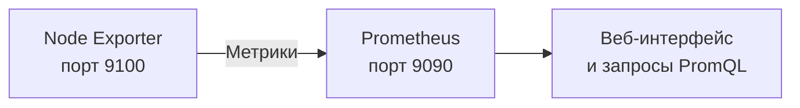

## 1. Что мы будем настраивать

В предыдущей теме мы разобрали, что Prometheus собирает и хранит метрики. Теперь посмотрим, как запустить его на Ubuntu и получить показатели сервера.

<mark style="background:#fff88f">Для простоты **Prometheus и Node Exporter будут работать на одной виртуальной машине**. В дальнейшем Prometheus сможет собирать метрики и с других серверов.</mark>

- <mark style="background:#fff88f">**Prometheus** — регулярно запрашивает метрики, сохраняет их и позволяет выполнять запросы.</mark>
- <mark style="background:#fff88f">**Node Exporter** — предоставляет метрики Linux: загрузку процессора, память, диски, сеть.</mark>
- <mark style="background:#fff88f">**PromQL** — язык запросов к метрикам Prometheus.</mark>



> [!INFO] Важный принцип
> Node Exporter не отправляет метрики самостоятельно. Prometheus обращается к нему через определённые промежутки времени — это модель **Pull**.

## 2. Подготовка Ubuntu

<mark style="background:#fff88f">Откроем терминал Ubuntu. Обновим список пакетов:</mark>

```bash
sudo apt update
```

## 3. Установка Prometheus

Установим Prometheus:

```bash
sudo apt install -y prometheus
```

Проверим, работает ли служба:

```bash
systemctl status prometheus
```

Если видим `active (running)`, служба запущена. Для выхода из просмотра состояния нажмите `q`.

Включим автоматический запуск при загрузке системы:

```bash
sudo systemctl enable prometheus
```

По умолчанию веб-интерфейс Prometheus использует **порт 9090**.

Откроем в браузере:

```text
http://IP_СЕРВЕРА:9090
```

Если браузер находится на самой Ubuntu, можно использовать `http://localhost:9090`.

> [!TIP] Как узнать IP-адрес
> Выполните `hostname -I`. Если интерфейс не открывается с другого компьютера, проверьте сетевую доступность и правила брандмауэра.

## 4. Установка Node Exporter

Prometheus сам по себе не предоставляет все показатели операционной системы. Для этого установим **Node Exporter**:

```bash
sudo apt install -y prometheus-node-exporter
```

Проверим службу:

```bash
systemctl status prometheus-node-exporter
```

Включим автозапуск:

```bash
sudo systemctl enable prometheus-node-exporter
```

Node Exporter обычно предоставляет метрики на **порту 9100** по адресу `/metrics`.

Проверим из терминала:

```bash
curl http://localhost:9100/metrics
```

Появится большой список метрик. Например, метрика `node_memory_MemAvailable_bytes` показывает доступную оперативную память в байтах.

> [!INFO] Endpoint
> **Endpoint** — адрес, по которому программа предоставляет метрики. В нашем случае это `http://localhost:9100/metrics`.

## 5. Настройка Prometheus

Чтобы Prometheus начал собирать метрики Node Exporter, нужно указать его адрес в конфигурации.

Откроем файл:

```bash
sudo nano /etc/prometheus/prometheus.yml
```

Найдём раздел `scrape_configs`. Он содержит список источников метрик. Для нашего примера конфигурация может выглядеть так:

```yaml
global:
  scrape_interval: 15s

scrape_configs:
  - job_name: "prometheus"
    static_configs:
      - targets: ["localhost:9090"]

  - job_name: "node"
    static_configs:
      - targets: ["localhost:9100"]
```

**Разберём основные параметры:**

| Параметр | Что означает |
|---|---|
| `global` | Общие настройки Prometheus |
| `scrape_interval: 15s` | Собирать метрики каждые 15 секунд |
| `scrape_configs` | Список источников метрик |
| `job_name` | Название группы источников |
| `static_configs` | Адреса, заданные вручную |
| `targets` | Адреса, откуда получать метрики |

Здесь два источника: сам Prometheus (`9090`) и Node Exporter (`9100`).

> [!WARNING] Отступы YAML
> В YAML важны пробелы. Не заменяйте их табуляцией. Неправильные отступы могут помешать запуску Prometheus.

Сохраним файл: `Ctrl+O`, `Enter`, затем `Ctrl+X`.

Проверим конфигурацию, если утилита `promtool` доступна:

```bash
promtool check config /etc/prometheus/prometheus.yml
```

Применим изменения:

```bash
sudo systemctl restart prometheus
```

Проверим состояние:

```bash
systemctl status prometheus
```

Если служба не запустилась, посмотрим сообщения об ошибках:

```bash
sudo journalctl -u prometheus -n 30 --no-pager
```

## 6. Проверка источников метрик

Откроем веб-интерфейс Prometheus и перейдём в **Status → Targets** (в некоторых версиях расположение меню может отличаться).

Там должны появиться два источника:

- `prometheus` — `localhost:9090`;
- `node` — `localhost:9100`.

Статус **UP** означает, что Prometheus успешно получил метрики. Статус **DOWN** означает, что запрос не удался.

> [!TIP] Если Node Exporter показывает DOWN
> Проверьте службу `prometheus-node-exporter`, адрес и порт в конфигурации, а также доступность `http://localhost:9100/metrics`.

## 7. Первые запросы PromQL

**PromQL** — язык запросов Prometheus. Он позволяет выбрать нужную метрику, отфильтровать данные и выполнить простые вычисления.

Откроем страницу запросов в веб-интерфейсе Prometheus. Вводим запрос и нажимаем **Execute**. Результат можно посмотреть в виде таблицы или графика.

### 7.1. Проверка доступности — `up`

```promql
up
```

Показывает состояние всех настроенных источников: `1` — доступен, `0` — недоступен.

Чтобы выбрать только Node Exporter:

```promql
up{job="node"}
```

Здесь `{job="node"}` — фильтр по метке `job`.

### 7.2. Доступная память

```promql
node_memory_MemAvailable_bytes
```

Метрика показывает доступную оперативную память **в байтах**. Чтобы получить значение в гигабайтах (ГиБ), разделим его на `1024³`:

```promql
node_memory_MemAvailable_bytes / 1024 / 1024 / 1024
```

Это пример обычного арифметического действия в PromQL.

### 7.3. Использование оперативной памяти в процентах

```promql
100 * (1 - node_memory_MemAvailable_bytes / node_memory_MemTotal_bytes)
```

Разбор:

1. `node_memory_MemTotal_bytes` — общий объём RAM.
2. `node_memory_MemAvailable_bytes` — доступная RAM.
3. Делим доступную память на общий объём.
4. Вычитаем результат из `1` и умножаем на `100`.

Получаем примерную долю используемой оперативной памяти.

### 7.4. Свободное место на диске

```promql
node_filesystem_avail_bytes{mountpoint="/"} / 1024 / 1024 / 1024
```

Запрос показывает доступное место в ГиБ на файловой системе, смонтированной в `/`. Если результатов несколько, они могут относиться к разным устройствам или типам файловых систем.

### 7.5. Изменение счётчика — `rate()`

Некоторые метрики постоянно увеличиваются. Например, `node_network_receive_bytes_total` считает количество байтов, полученных сетевым интерфейсом.

```promql
rate(node_network_receive_bytes_total[5m])
```

**`rate()`** рассчитывает среднюю скорость увеличения счётчика за указанный период. `[5m]` означает последние пять минут.

Результат здесь измеряется в **байтах в секунду**.

> [!INFO] Почему нельзя просто смотреть на счётчик?
> Само значение счётчика показывает накопленный объём данных. `rate()` помогает узнать, с какой скоростью этот объём увеличивается.

### 7.6. Суммирование — `sum()`

Если несколько сетевых интерфейсов, запрос вернёт отдельный результат для каждого. Для суммирования используем `sum()`:

```promql
sum(rate(node_network_receive_bytes_total[5m]))
```

**`sum()`** складывает полученные значения. В этом примере — скорости получения данных всеми интерфейсами, попавшими в запрос.

### 7.7. Среднее значение — `avg()`

```promql
avg(up)
```

**`avg()`** вычисляет среднее значение. Для `up` результат показывает долю доступных источников среди выбранных. Например, `1` означает, что все источники доступны.

## 8. Что важно запомнить

- Prometheus собирает и хранит метрики.
- Node Exporter предоставляет показатели Linux-сервера через `/metrics`.
- В `prometheus.yml` задаются источники метрик и интервал сбора.
- В разделе Targets можно проверить, успешно ли Prometheus обращается к источникам.
- PromQL позволяет выбирать метрики, фильтровать их по меткам и выполнять вычисления.
- `rate()` показывает скорость изменения счётчика, `sum()` складывает значения, `avg()` вычисляет среднее.

## Вопросы для самопроверки

1. Для чего нужен Node Exporter, если уже установлен Prometheus?
2. Что означает `scrape_interval: 15s`?
3. Чем отличаются `job_name` и `targets`?
4. Что означают состояния UP и DOWN?
5. Что делает выражение `{job="node"}`?
6. Зачем нужна функция `rate()`?
7. Чем отличаются `sum()` и `avg()`?

> [!TIP] Следующая тема
> После получения метрик можно перейти к **Grafana**: подключить Prometheus как источник данных и построить графики CPU, RAM, дисков и сети.
