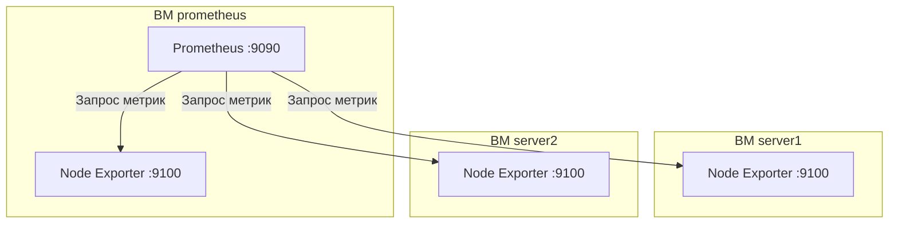

## Цель работы

Научиться устанавливать Prometheus и Node Exporter, настраивать сбор метрик с нескольких серверов, проверять доступность источников и выполнять простые запросы PromQL.

## Предварительная информация

- **Proxmox:** `http://proxmox.ggkit.local:8006`.
- **Шаблон:** `students-ubuntu26.04-template`.
- **Тип клонирования:** полный клон (Full Clone).
- **Логин:** `user`.
- **Пароль:** `P@ssw0rd`.
- Для выполнения задания нужно склонировать **две** виртуалки
	- `bsi-practicheskaya-rabota-5-prometheus`
	- `bsi-practicheskaya-rabota-5-server1`
	- `bsi-practicheskaya-rabota-5-server2`
- Для выполнения работы необходимо создать три виртуальные машины.
- В сети поднят DHCP-сервер. Для узнавания IP-адресов используйте команду `ip -c -br a`.

| Имя ВМ в Proxmox | Имя системы | Установленные службы |
|---|---|---|
| `oaks-prometheus` | `prometheus` | Prometheus, Node Exporter |
| `oaks-server1` | `server1` | Node Exporter |
| `oaks-server2` | `server2` | Node Exporter |

Prometheus будет собирать метрики операционной системы со всех трёх ВМ каждые 15 секунд.



## Требования к отчёту

Отчёт оформляется в **LibreOffice Writer**. Имя файла: `PR2-Имя_Фамилия.odt`.

1. Титульный лист: номер и название практической работы, ФИО и группа.
2. Вторая страница: цель работы.
3. Далее каждое задание с новой страницы: что выполнено, использованные команды, читаемые скриншоты результатов и краткие пояснения.

>[!DANGER] Куда скинуть отчет
>ПО ОКОНЧАНИЮ СКИНУТЬ В `Сеть для лабораторий/308а/С1.23.41`.

## Критерии оценки

- Все задания выполнены.
- В отчёте есть команды, результат и ответы на вопросы «зачем?».
- Студент понимает, что делает каждая команда.
- Оформление соответствует требованиям LibreOffice Writer.

---

# Задания

## Задание 1. Подготовка виртуальных машин

**Цель:** подготовить три сервера для настройки мониторинга.

1. Создайте три полных клона шаблона `students-ubuntu26.04-template` с именами из таблицы выше.
2. Запустите ВМ и задайте имена систем.

На ВМ `prometheus`:

```bash
sudo hostnamectl set-hostname prometheus
exec bash
```

На ВМ `server1`:

```bash
sudo hostnamectl set-hostname server1
exec bash
```

На ВМ `server2`:

```bash
sudo hostnamectl set-hostname server2
exec bash
```

3. На каждой ВМ определите IP-адрес:

```bash
ip -c -br a
```

Запишите IPv4-адреса всех трёх ВМ. Они понадобятся при настройке Prometheus.

**В отчёт:** скриншот трёх ВМ в Proxmox и таблица с их именами и IP-адресами.

## Задание 2. Установка Prometheus

**Цель:** установить сервер сбора и хранения метрик.

Все команды данного задания выполнить только на ВМ `prometheus`.

1. Установите Prometheus:

```bash
sudo apt update
sudo apt install -y prometheus
```

2. Включите автоматический запуск службы и проверьте её состояние:

```bash
sudo systemctl enable --now prometheus
systemctl status prometheus
```

Для выхода из просмотра состояния нажмите `q`.

3. Откройте веб-интерфейс Prometheus в браузере на рабочем компьютере:

```text
http://<IP_prometheus>:9090
```

Вместо `<IP_prometheus>` укажите IPv4-адрес ВМ `prometheus`.

**В отчёт:** состояние службы и скриншот веб-интерфейса Prometheus.

## Задание 3. Установка Node Exporter

**Цель:** обеспечить получение метрик Linux со всех трёх серверов.

1. На каждой из трёх ВМ установите Node Exporter:

```bash
sudo apt update
sudo apt install -y prometheus-node-exporter
```

2. Включите автоматический запуск и проверьте состояние службы на каждой ВМ:

```bash
sudo systemctl enable --now prometheus-node-exporter
systemctl status prometheus-node-exporter
```

3. Проверьте получение метрик на каждой ВМ:

```bash
curl http://localhost:9100/metrics
```

Если `curl` отсутствует, установите его командой `sudo apt install -y curl`.

Node Exporter предоставляет метрики процессора, оперативной памяти, дисков и сети через порт `9100`.

**В отчёт:** состояние Node Exporter и фрагмент вывода метрик на каждой ВМ.

## Задание 4. Настройка сбора метрик

**Цель:** подключить все три ВМ к Prometheus.

1. На ВМ `prometheus` откройте файл конфигурации:

```bash
sudo nano /etc/prometheus/prometheus.yml
```

2. Замените содержимое файла следующей конфигурацией:

```yaml
global:
  scrape_interval: 15s

scrape_configs:
  - job_name: "prometheus"
    static_configs:
      - targets: ["localhost:9090"]

  - job_name: "node"
    static_configs:
      - targets:
          - "localhost:9100"
          - "IP_SERVER1:9100"
          - "IP_SERVER2:9100"
```

Вместо `IP_SERVER1` и `IP_SERVER2` укажите реальные IPv4-адреса соответствующих ВМ. `localhost:9100` — Node Exporter на самой ВМ `prometheus`.

Сохраните файл (`Ctrl+O`, `Enter`) и закройте редактор (`Ctrl+X`).

3. Проверьте конфигурацию и перезапустите Prometheus:

```bash
promtool check config /etc/prometheus/prometheus.yml
sudo systemctl restart prometheus
```

При наличии ошибок в конфигурации исправьте их перед перезапуском.

4. В веб-интерфейсе откройте страницу **Status → Targets** или перейдите по адресу:

```text
http://<IP_prometheus>:9090/targets
```

Дождитесь сбора метрик. Все четыре источника должны иметь состояние `UP`: три Node Exporter и сам Prometheus.

**В отчёт:** конфигурация Prometheus и скриншот страницы Targets со всеми источниками в состоянии `UP`.

## Задание 5. Выполнение запросов PromQL

**Цель:** получить показатели состояния всех трёх серверов.

Откройте страницу запросов в веб-интерфейсе Prometheus. Поочерёдно выполните следующие запросы, нажимая **Execute**.

1. Доступность трёх Node Exporter:

```promql
up{job="node"}
```

2. Доступная оперативная память в ГБ:

```promql
node_memory_MemAvailable_bytes / 1024 / 1024 / 1024
```

3. Использование оперативной памяти в процентах:

```promql
100 * (1 - node_memory_MemAvailable_bytes / node_memory_MemTotal_bytes)
```

4. Свободное место на корневой файловой системе в ГБ:

```promql
node_filesystem_avail_bytes{mountpoint="/"} / 1024 / 1024 / 1024
```

5. Средняя загрузка процессора каждой ВМ в процентах:

```promql
100 * (1 - avg by (instance) (rate(node_cpu_seconds_total{mode="idle"}[5m])))
```

`avg by (instance)` вычисляет среднее значение по процессорам отдельно для каждой ВМ. Для просмотра изменения загрузки во времени переключитесь на график (Graph). Если данных пока мало, подождите несколько минут.

**В отчёт:** результаты пяти запросов и график загрузки процессора. Укажите, какой результат относится к каждой ВМ, используя метку `instance`.

## Задание 6. Проверка недоступности источника метрик

**Цель:** проверить, как Prometheus обнаруживает недоступность Node Exporter.

1. На ВМ `server2` остановите Node Exporter:

```bash
sudo systemctl stop prometheus-node-exporter
```

2. Подождите 30 секунд и выполните в Prometheus запрос:

```promql
up{job="node"}
```

Для `server2` значение должно стать `0`, для остальных ВМ — остаться `1`.

3. На ВМ `server2` снова запустите службу:

```bash
sudo systemctl start prometheus-node-exporter
```

4. Подождите 30 секунд и повторите запрос. Все три значения должны быть равны `1`.

**В отчёт:** результаты запроса до и после восстановления службы Node Exporter.