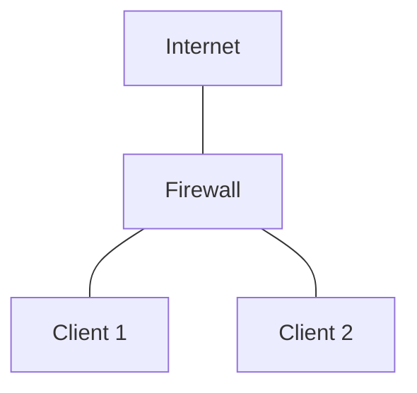

## Цель работы

Изучить архитектуру Netfilter/iptables, освоить базовую фильтрацию пакетов, stateful inspection, NAT, пользовательские цепочки и сохранение правил. На практике собрать стенд из трёх виртуальных машин в Proxmox, где один хост выполняет роль firewall/маршрутизатора между двумя другими хостами.

### Необходимое ПО и ресурсы

- Proxmox VE (любая актуальная версия).
- 3 виртуальные машины на базе Ubuntu Server 24.04.
- Два изолированных Linux-моста в Proxmox:
    - `C1.23.41-{{user_index}}-1`
    - `C1.23.41-{{user_index}}-2`
- Утилиты в ВМ: `iptables`, `openssh-server`, `iptables-persistent`, `tcpdump`, `conntrack`, `nmap`.

> [!INFO] Создание мостов
> `{{user_index}}` — номер студента по журналу. Например, для студента №1: `C1.23.41-1-1` и `C1.23.41-1-2`.


### Топология сети



|Узел|IP-адрес|Шлюз|Мост|Описание соединения|
|---|---|---|---|---|
|Firewall|DHCP|DHCP|vmbr0|Firewall ↔ INTERNET|
|Firewall|10.10.10.1/24|—|C1.23.41-{{user_index}}-1|Firewall ↔ Client 1|
|Firewall|192.168.2.1/24|—|C1.23.41-{{user_index}}-2|Firewall ↔ Client 2|
|Client 1|10.10.10.10/24|10.10.10.1|C1.23.41-{{user_index}}-1|Client 1 ↔ Firewall|
|Client 2|192.168.2.100/24|192.168.2.1|C1.23.41-{{user_index}}-2|Client 2 ↔ Firewall|
### Обозначения

- `<WAN>` — интерфейс Firewall, подключённый к `vmbr0` (например, `ens18`).
- `<LAN1>` — интерфейс Firewall, подключённый к мосту Client 1 (например, `ens19`).
- `<LAN2>` — интерфейс Firewall, подключённый к мосту Client 2 (например, `ens20`).

## Предварительная информация

- Рабочая среда: Proxmox VE, три ВМ Ubuntu Server 24.04.
- Используются два изолированных моста, заранее созданных администратором.
- `{{user_index}}` — номер студента по журналу.
- Все настройки выполняются через консоль ВМ в Proxmox. Перед изменением правил убедитесь, что консоль доступна.

## Требования к отчёту

Отчёт оформите в LibreOffice Writer и сохраните как `PR-Имя_Фамилия.odt` (номер работы уточните у преподавателя).

1. Титульный лист: название работы, ФИО и группа.
2. Вторая страница: цель работы, топология и названия заданий.
3. Каждое задание — с новой страницы: действия, команды, читаемые скриншоты и краткие пояснения.
4. Последняя страница: ответы на вопросы для защиты.

**Сдать отчёт:** `Сеть для лабораторий/308а/С1.23.41`.

## Критерии оценки

- Настроены три ВМ, IP-адресация и маршрутизация.
- Правила фильтрации, NAT и ограничения доступа работают согласно условиям.
- Продемонстрированы состояния соединений и диагностика.
- Правила сохраняются после перезагрузки.
- В отчёте есть команды, результаты и объяснения.

---

# Задания

## Задание 1. Подготовка виртуальных машин и установка ПО

**Цель:** собрать лабораторную топологию, сопоставить сетевые интерфейсы и установить необходимые утилиты.

**Задание:** создайте три ВМ, подключите интерфейсы к соответствующим мостам, установите пакеты и проверьте SSH.

**Выполнение**

#### 1. Создание виртуальных машин

Мосты уже созданы администратором. При создании ВМ нужно просто выбрать нужный мост в настройках сетевого устройства.

#### Firewall

Создайте ВМ с **тремя** сетевыми интерфейсами:

|Устройство|Мост|Назначение|
|---|---|---|
|net0|vmbr0|WAN|
|net1|C1.23.41-{{user_index}}-1|LAN1|
|net2|C1.23.41-{{user_index}}-2|LAN2|

Модель: **VirtIO (paravirtualized)**.

#### Client 1

Создайте ВМ с **одним** сетевым интерфейсом:

|Устройство|Мост|
|---|---|
|net0|C1.23.41-{{user_index}}-1|

#### Client 2

Создайте ВМ с **одним** сетевым интерфейсом:

|Устройство|Мост|
|---|---|
|net0|C1.23.41-{{user_index}}-2|

#### 2. Как понять, какой интерфейс в Linux соответствует какому мосту

1. В Proxmox откройте **VM → Hardware**. Для каждого сетевого устройства будет указан **MAC-адрес**.
2. Запишите MAC-адреса:
    - Firewall: net0, net1, net2.
    - Client 1: net0.
    - Client 2: net0.
3. Зайдите в ВМ через консоль Proxmox (noVNC/SPICE) и выполните:

```bash
ip -br link
```

Вы увидите примерно:

```
lo               UNKNOWN        00:00:00:00:00:00
ens18            UP             bc:24:11:aa:bb:cc
ens19            UP             bc:24:11:dd:ee:ff
ens20            UP             bc:24:11:11:22:33
```

Сопоставьте MAC-адреса из Proxmox с интерфейсами в Linux.  
Например:

- `ens18` → net0 (vmbr0, WAN)
- `ens19` → net1 (C1.23.41-{{user_index}}-1, LAN1)
- `ens20` → net2 (C1.23.41-{{user_index}}-2, LAN2)

Если интерфейсы называются иначе (`enp0s18`, `eth0` и т.п.) — используйте свои имена.

#### 3. Установка базового ПО

На **Client 1 и Client 2** выполните:

```bash
sudo apt update
sudo apt install -y iptables openssh-server curl
```

На `Firewall` выполните:

```bash
sudo apt update
sudo apt install -y iptables openssh-server iptables-persistent tcpdump conntrack nmap curl
```

Во время установки `iptables-persistent` может спросить о сохранении текущих правил.  
Для первичной настройки выберите **No** (сохраним позже вручную).

Включаем SSH:

```bash
sudo systemctl enable --now ssh
sudo systemctl status ssh
ss -tlnp | grep :22
```

**В отчёт:** скриншоты сетевых устройств ВМ в Proxmox, сопоставление MAC-адресов и интерфейсов, проверка SSH.

## Задание 2. Настройка IP-адресов и маршрутизации

**Цель:** настроить Netplan и разрешить маршрутизацию IPv4 между сетями.

**Задание:** назначьте адреса по таблице топологии, проверьте доступность Firewall с обеих клиентских ВМ и включите IP forwarding.

**Выполнение**

#### 4. Настройка IP-адресов через Netplan

В Ubuntu Server 24.04 сеть настраивается через Netplan.  
Создайте или отредактируйте файл `/etc/netplan/99-lab.yaml`.

```bash
sudo nano /etc/netplan/99-lab.yaml
```
#### Firewall

Замените `ens18`, `ens19`, `ens20` на свои интерфейсы.

```yaml
network:
  version: 2
  renderer: networkd
  ethernets:
    ens18:
      dhcp4: true
    ens19:
      dhcp4: false
      addresses:
        - 10.10.10.1/24
    ens20:
      dhcp4: false
      addresses:
        - 192.168.2.1/24
```

Примените настройки сети:

```bash
sudo chmod 600 /etc/netplan/99-lab.yaml
sudo netplan apply
```


Проверьте:

```
ip -br addr
ip route
```

Ожидаемо:

- `ens18` получил DHCP-адрес от vmbr0.
- `ens19` — `10.10.10.1/24`.
- `ens20` — `192.168.2.1/24`.

#### Client 1

Создайте или отредактируйте файл `/etc/netplan/99-lab.yaml`.

```bash
sudo nano /etc/netplan/99-lab.yaml
```

```yml
network:
  version: 2
  renderer: networkd
  ethernets:
    ens18:
      dhcp4: false
      addresses:
        - 10.10.10.10/24
      routes:
        - to: default
          via: 10.10.10.1
      nameservers:
        addresses: [8.8.8.8, 1.1.1.1]
```

Примените настройки сети:

```bash
sudo chmod 600 /etc/netplan/99-lab.yaml
sudo netplan apply
```

Проверьте:

```
ip -br addr
ip route
```

#### Client 2

Создайте или отредактируйте файл `/etc/netplan/99-lab.yaml`.

```bash
sudo nano /etc/netplan/99-lab.yaml
```

```yml
network:
  version: 2
  renderer: networkd
  ethernets:
    ens18:
      dhcp4: false
      addresses:
        - 192.168.2.100/24
      routes:
        - to: default
          via: 192.168.2.1
      nameservers:
        addresses: [8.8.8.8, 1.1.1.1]
```

Примените настройки сети:

```bash
sudo chmod 600 /etc/netplan/99-lab.yaml
sudo netplan apply
```

Проверьте:

```
ip -br addr
ip route
```

Проверьте связность:
- Client 1 → Firewall: `ping -c 3 10.10.10.1`
- Client 2 → Firewall: `ping -c 3 192.168.2.1`
- Firewall → Client 1: `ping -c 3 10.10.10.10`
- Firewall → Client 2: `ping -c 3 192.168.2.100`

#### 5. Включение IP-форвардинга на Firewall

Без этого FORWARD пакетов между Client 1 и Client 2 работать не будет.

```bash
sudo sysctl -w net.ipv4.ip_forward=1
echo 'net.ipv4.ip_forward=1' | sudo tee /etc/sysctl.d/99-ipforward.conf
sudo sysctl --system
```

Проверка:

```bash
cat /proc/sys/net/ipv4/ip_forward
```

Должно быть `1`.

**В отчёт:** конфигурации Netplan, вывод `ip -br addr`, `ip route`, результаты `ping` и значение `ip_forward`.

## Задание 3. Базовая фильтрация ICMP и SSH

**Цель:** настроить разрешающие и запрещающие правила в цепочках FORWARD и INPUT.

**Задание:** разрешите Client 1 обращаться к Client 2 по ICMP, запретите обратные новые ICMP-запросы, разрешите SSH к Firewall только с Client 2.

**Выполнение**

#### 1. Очистка правил перед началом

На Firewall выполните:

```bash
sudo iptables -F
sudo iptables -t nat -F
sudo iptables -X
sudo iptables -P INPUT ACCEPT
sudo iptables -P FORWARD ACCEPT
sudo iptables -P OUTPUT ACCEPT
```

#### 2. Разрешить Client 1 пинговать Client 2

Сначала убедитесь, что маршрутизация работает: с Client 1 выполните `ping 192.168.2.100`.  
При политике `FORWARD ACCEPT` пинг должен проходить.  
Теперь добавим явное правило для ICMP:

```bash
sudo iptables -A FORWARD -i <LAN1> -o <LAN2> \
  -s 10.10.10.10 -d 192.168.2.100 \
  -p icmp -m conntrack --ctstate NEW -j ACCEPT
```

Проверка с Client 1:

```bash
ping -c 3 192.168.2.100
```

#### 3. Запретить Client 2 пинговать Client 1

```bash
sudo iptables -I FORWARD 1 -i <LAN2> -o <LAN1> \
  -s 192.168.2.100 -d 10.10.10.10 \
  -p icmp -j DROP
```

Проверка:

- С Client 2: `ping 10.10.10.10` → должно быть `100% packet loss`.
- С Client 1: `ping 192.168.2.100` → должно работать.

#### 4. Разрешить SSH на Firewall с Client 2 и запретить с Client 1

```bash
sudo iptables -A INPUT -i <LAN2> -s 192.168.2.100 \
  -p tcp --dport 22 -m conntrack --ctstate NEW -j ACCEPT

sudo iptables -A INPUT -i <LAN1> -s 10.10.10.10 \
  -p tcp --dport 22 -j DROP
```

Проверка:

- С Client 2: `ssh user@192.168.2.1` → работает.
- С Client 1: `ssh user@10.10.10.1` → зависает/таймаут.

> **Важно:** для асимметричного ICMP необходимо разрешить ответные пакеты `ESTABLISHED,RELATED` до запрещающего правила. Иначе правило DROP для обратного направления может блокировать и ответы на запросы Client 1.

На Firewall добавьте перед правилом запрета:

```bash
sudo iptables -I FORWARD 1 -m conntrack --ctstate ESTABLISHED,RELATED -j ACCEPT
```

При политике `INPUT ACCEPT` разрешающее правило SSH само по себе не ограничивает доступ других адресов. Для проверки запрета Client 1 используйте явное правило DROP из приведённой реализации.

**В отчёт:** вывод `sudo iptables -L -n -v --line-numbers`, результаты ICMP и SSH с обоих клиентов.

## Задание 4. Настройка NAT и политик по умолчанию

**Цель:** обеспечить доступ клиентов к внешней сети через MASQUERADE и изучить stateful inspection.

**Задание:** настройте NAT, проверьте интернет с клиентов, добавьте правила для существующих соединений и установите политики DROP.

**Выполнение**

#### 5. Проверить выход в интернет через NAT/MASQUERADE

На Firewall:

```bash
sudo iptables -t nat -A POSTROUTING -s 10.10.10.0/24 -o <WAN> -j MASQUERADE
sudo iptables -t nat -A POSTROUTING -s 192.168.2.0/24 -o <WAN> -j MASQUERADE

sudo iptables -A FORWARD -i <LAN1> -o <WAN> -s 10.10.10.0/24 -j ACCEPT
sudo iptables -A FORWARD -i <LAN2> -o <WAN> -s 192.168.2.0/24 -j ACCEPT

sudo iptables -A FORWARD -i <WAN> -o <LAN1> -d 10.10.10.0/24 \
  -m conntrack --ctstate ESTABLISHED,RELATED -j ACCEPT
sudo iptables -A FORWARD -i <WAN> -o <LAN2> -d 192.168.2.0/24 \
  -m conntrack --ctstate ESTABLISHED,RELATED -j ACCEPT
```

Проверка с обоих клиентов:

```bash
ping -c3 8.8.8.8
```

#### 1. Установить политику DROP по умолчанию

Сначала добавьте правила, чтобы не потерять управление.

```bash
# Разрешаем локальную петлю
sudo iptables -A INPUT -i lo -j ACCEPT
sudo iptables -A OUTPUT -o lo -j ACCEPT

# «Золотое правило» stateful inspection
sudo iptables -A INPUT -m conntrack --ctstate ESTABLISHED,RELATED -j ACCEPT
sudo iptables -A OUTPUT -m conntrack --ctstate ESTABLISHED,RELATED -j ACCEPT
sudo iptables -A FORWARD -m conntrack --ctstate ESTABLISHED,RELATED -j ACCEPT

# Разрешаем SSH на firewall с Client 2
sudo iptables -A INPUT -i <LAN2> -s 192.168.2.100 \
  -p tcp --dport 22 -m conntrack --ctstate NEW -j ACCEPT

# Разрешаем ICMP на firewall от Client 2
sudo iptables -A INPUT -i <LAN2> -s 192.168.2.100 \
  -p icmp -j ACCEPT

# Разрешаем исходящие DNS/HTTP/HTTPS для apt и диагностики
sudo iptables -A OUTPUT -p udp --dport 53 -j ACCEPT
sudo iptables -A OUTPUT -p tcp --dport 53 -j ACCEPT
sudo iptables -A OUTPUT -p tcp -m multiport --dports 80,443 -j ACCEPT

# Разрешаем новые соединения из LAN в WAN
sudo iptables -A FORWARD -i <LAN1> -o <wan_if> -s 10.10.10.0/24 \
  -m conntrack --ctstate NEW -j ACCEPT
sudo iptables -A FORWARD -i <LAN2> -o <wan_if> -s 192.168.2.0/24 \
  -m conntrack --ctstate NEW -j ACCEPT

# Теперь включаем политики DROP
sudo iptables -P INPUT DROP
sudo iptables -P FORWARD DROP
sudo iptables -P OUTPUT DROP
```

Проверьте, что SSH с Client 2 всё ещё работает.

> **Важно:** в командах замените `<WAN>`, `<LAN1>`, `<LAN2>` и `<wan_if>` на реальные имена интерфейсов. Перед установкой `OUTPUT DROP` необходимо разрешить исходящий DHCP на WAN, если адрес Firewall получен по DHCP. Не устанавливайте DROP, пока не проверили доступ через консоль Proxmox.

Для DHCP-клиента на WAN до `OUTPUT DROP`:

```bash
sudo iptables -A OUTPUT -o <WAN> -p udp --sport 68 --dport 67 -j ACCEPT
sudo iptables -A INPUT -i <WAN> -p udp --sport 67 --dport 68 -j ACCEPT
```

**В отчёт:** таблица NAT, проверка внешней связности, политики INPUT/FORWARD/OUTPUT, объяснение `ESTABLISHED,RELATED`.

## Задание 5. Дополнительные модули фильтрации

**Цель:** познакомиться с ограничением ICMP, частоты SSH-подключений, модулем multiport и правилами по времени.

**Задание:** выполните настройки из четырёх подразделов, проверьте счётчики правил и доступность сервисов.

**Выполнение**

#### 1. Ограничить ICMP на Firewall

Разрешить пинг из LAN2 (мониторинг), запретить из WAN.

```bash
# Запрет ICMP echo-request с WAN
sudo iptables -I INPUT 1 -i <WAN> -p icmp -j DROP

# Разрешение ICMP echo-request из LAN2
sudo iptables -I INPUT 1 -i <LAN2> -s 192.168.2.0/24 \
  -p icmp -m conntrack --ctstate NEW -j ACCEPT
```

Проверка:

- С Client 2: `ping 192.168.2.1` → работает.
- С Proxmox-хоста: `ping <WAN_DHCP_IP>` → таймаут. Проверяет администратор

#### 2. Rate limiting для SSH

Защита от брутфорса через `-m recent`.

```bash
sudo iptables -I INPUT 1 -p tcp --dport 22 -m conntrack --ctstate NEW \
  -m recent --update --seconds 60 --hitcount 4 --name SSH -j DROP

sudo iptables -I INPUT 2 -p tcp --dport 22 -m conntrack --ctstate NEW \
  -m recent --set --name SSH
```

Проверка:

```bash
for i in {1..6}; do ssh -o BatchMode=yes -o ConnectTimeout=1 wrong@192.168.2.1; done
```

После 4 попыток соединение начнёт отбрасываться.  
Посмотрите счётчики:

```bash
sudo iptables -L INPUT -n -v --line-numbers
```

#### 3. multiport

Разрешить доступ к портам `22,80,443` одной строкой:

```bash
sudo iptables -A INPUT -p tcp -m multiport --dports 22,80,443 -j ACCEPT
```

Проверьте:

```bash
sudo iptables -L INPUT -n -v
```

#### 4. time-модуль

Разрешить доступ к порту 80 только в рабочие часы.

```bash
sudo iptables -I INPUT 1 -p tcp --dport 80 \
  -m time --timestart 09:00 --timestop 18:00 \
  --days Mon,Tue,Wed,Thu,Fri --kerneltz -j ACCEPT

sudo iptables -I INPUT 2 -p tcp --dport 80 -j DROP
```

Установите на Firewall простой веб-сервер:

```bash
sudo python3 -m http.server 80
```

Проверка:

- С Client 2: `curl http://192.168.2.1` → работает в рабочие часы.
- Измените время:
```bash
sudo timedatectl set-ntp false
sudo date -s "2026-10-01 20:00:00"
```

Повторите `curl` → должно быть отказано.  
Верните NTP:

```bash
sudo timedatectl set-ntp true
```

> **Важно:** правила `iptables` проверяются сверху вниз. Общее разрешение порта 80 или SSH, добавленное ранее, может обойти ограничения по времени или частоте. Проверьте порядок правил через `sudo iptables -L INPUT -n -v --line-numbers`. Проверку времени проводите только в лабораторной ВМ; после эксперимента восстановите синхронизацию.

**В отчёт:** команды для четырёх модулей, счётчики срабатываний и результаты проверки доступа.

## Задание 6. Диагностика и сохранение правил

**Цель:** просмотреть таблицу соединений и проверить сохранение настроек после перезагрузки.

**Задание:** изучите состояния соединений, сохраните правила, перезагрузите Firewall и повторно проверьте фильтрацию и NAT.

**Выполнение**

#### 1. Посмотреть таблицу conntrack

```bash
sudo conntrack -L
```

#### 2. Сохранить правила

```bash
sudo netfilter-persistent save
```

Проверьте файл:

```bash
sudo cat /etc/iptables/rules.v4
```

Перезагрузите Firewall:

```bash
reboot
```

После загрузки проверьте:

```bash
sudo iptables -L -n -v
sudo iptables -t nat -L -n -v
```

Правила должны сохраниться.

**В отчёт:** вывод `conntrack -L`, проверка сохранённых правил до и после перезагрузки.

