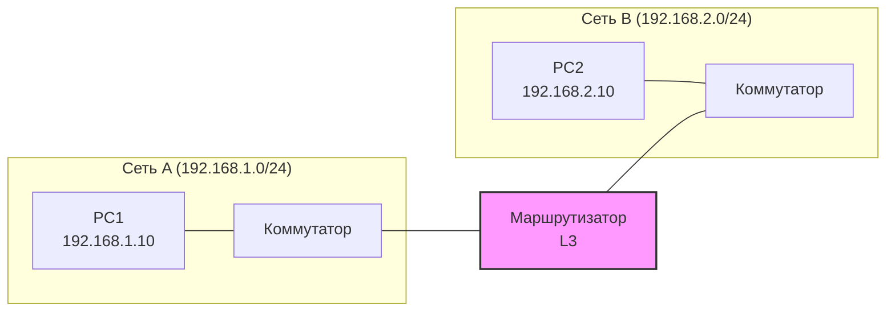

## Зачем нужна маршрутизация

**Коммутация (L2)** работает в пределах одного **широковещательного домена** (одной подсети). Коммутатор знает MAC-адреса устройств и передаёт кадры между портами.

Но что делать, если устройства находятся в **разных подсетях**? Коммутатор не знает, куда отправлять кадр, если MAC-адрес назначения ему неизвестен, а широковещательный домен ограничен.

**Маршрутизация (L3)** — это процесс передачи пакетов между **разными сетями** (подсетями) с помощью **маршрутизатора**.

> [!INFO] Ключевая идея:
Коммутация = внутри одной сети. Маршрутизация = между разными сетями.



## Пакет vs Кадр

Это **фундаментальное** различие для понимания маршрутизации.

### Кадр (Frame) — L2

- **Что это:** Блок данных на канальном уровне.
- **Адресация:** MAC-адреса (физические адреса).
- **Где живёт:** Внутри одной подсети / широковещательного домена.
- **Кто обрабатывает:** Коммутатор.
- **Заголовок:** MAC источника, MAC назначения, тип EtherType.

### Пакет (Packet) — L3

- **Что это:** Блок данных на сетевом уровне.
- **Адресация:** IP-адреса (логические адреса).
- **Где живёт:** Может путешествовать между разными сетями.
- **Кто обрабатывает:** Маршрутизатор.
- **Заголовок:** IP источника, IP назначения, TTL, протокол.

## IP-адрес

**IP-адрес** — это логический адрес устройства в сети. Он состоит из двух частей:

1. **Сеть (Network)** — определяет, к какой подсети принадлежит устройство.
2. **Хост (Host)** — определяет конкретное устройство внутри подсети.

### Формат IPv4

- 32 бита, записывается как 4 октета: `192.168.1.10`
- Каждый октет: 0–255

### Пример разбора

```
IP:    192.168.1.10
Маска: 255.255.255.0
```

- **Сеть:** `192.168.1.0`
- **Хост:** `.10`