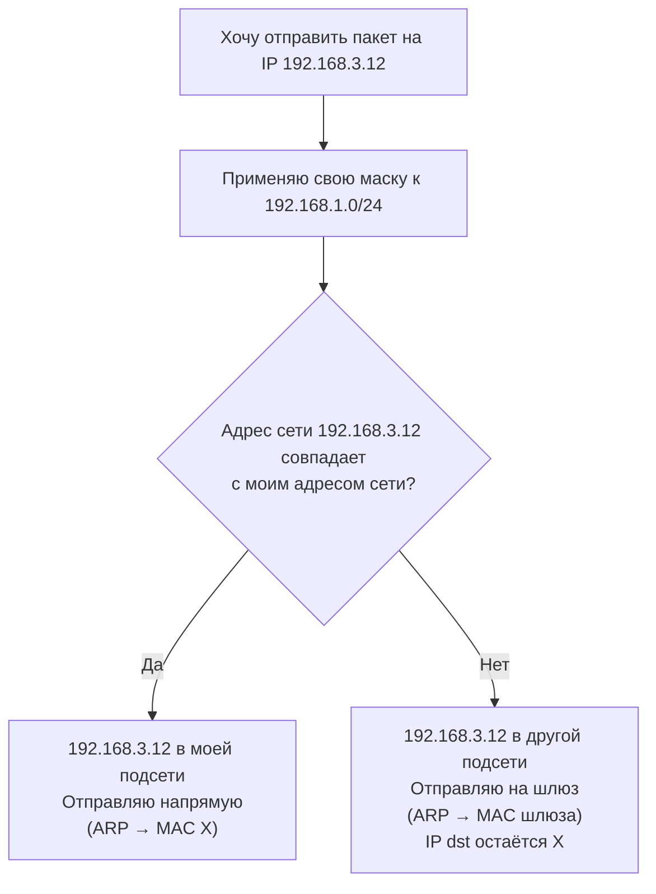

## Зачем нужна маршрутизация

На L2 (канальный уровень) устройства общаются **в пределах одного широковещательного домена** (одной подсети). Коммутатор L2 знает только MAC-адреса и умеет передавать кадры внутри своей сети.

Как только нужно **выйти за пределы своей подсети** (в другую сеть, в интернет) — L2 бессилен. Для этого применяется **L3 (сетевой уровень)** и **маршрутизатор (router)**.

>[!INFO] Определение:
>Маршрутизация — это процесс выбора пути для пакета между разными подсетями на основе IP-адреса.

## Пакет и кадр

- **Пакет (Packet, L3):** Это логическая единица данных, которая содержит **IP-адреса** источника и назначения.
- **Кадр (Frame, L2):** Это физическая единица данных, которая содержит **MAC-адреса** источника и назначения.

>[!WARNING] Важное правило:
>При прохождении через маршрутизатор IP-адреса в пакете (обычно) не меняются, а MAC-адреса в кадре переписываются полностью на каждом новом сегменте сети.

| Характеристика     | Кадр (Frame)                            | Пакет (Packet)                               |
| ------------------ | --------------------------------------- | -------------------------------------------- |
| Уровень            | L2 (канальный)                          | L3 (сетевой)                                 |
| Адресация          | MAC-адрес                               | IP-адрес                                     |
| Область жизни      | Внутри одного широковещательного домена | От источника до получателя через много сетей |
| Кто обрабатывает   | Коммутатор                              | Маршрутизатор                                |
| Меняется ли в пути | MAC меняется на каждом хопе             | IP-адреса **НЕ меняются** (кроме NAT)        |
## IP-адрес

Чтобы маршрутизатор мог принимать решения, ему нужно понимать структуру адреса.

**IP-адрес** состоит из двух логических частей:

1. **Идентификатор сети (Network ID):** Указывает на конкретную сеть (как название города и улицы).
2. **Идентификатор узла (Host ID):** Указывает на конкретное устройство в этой сети (как номер дома).

### IPv4

- 32 бита, записывается как 4 октета: `192.168.1.10`
- Каждый октет — 8 бит (0–255).

### Пример разбора

```bash
IP:    192.168.1.10
Маска: 255.255.255.0
```

Здесь:

- Сеть: `192.168.1.0`
- Хост: `.10`

>[!WARNING] Важно
>Два устройства могут общаться **напрямую** (без маршрутизатора), только если они **в одной подсети**. Иначе — только через маршрутизатор.

## Служебные IP адреса

Допустим есть маска 255.255.255.0

- Всего адресов: **256** (от `192.168.1.0` до `192.168.1.255`).
- **Служебные адреса:**
    - `192.168.1.0` — адрес сети (служебный). Он определяет саму подсеть и используется маршрутизаторами для направления трафика.
    - `192.168.1.255` — широковещательный адрес (служебный). Он используется для отправки пакетов сразу всем устройствам внутри этой подсети

- **Доступные для устройств (хостов):** **254** адреса (в диапазоне от `192.168.1.1` до `192.168.1.254`)

## Маска подсети

**Маска подсети (Subnet Mask)** — это не просто число, это правило, которое говорит устройству, где именно в IP-адресе заканчивается подсеть и начинается часть узла. Без маски подсети IP-адрес теряет смысл, так как устройство не сможет определить, находится ли целевой IP в той же локальной сети или за ее пределами.

### Форматы записи

- Десятичный: `255.255.255.0`
- Префиксный (CIDR): `/24` — означает 24 единицы в маске.

Соответствие:

![[images.jpg|733]]

### Как определить, в одной ли подсети устройства

Если у двух устройств адреса сетей совпадают — они в одной подсети.

**Пример 1:**

```
A: 192.168.1.10/24
B: 192.168.1.200/24

A: 192.168.1.10 -> 255.255.255.0 = 192.168.1.0
B: 192.168.1.200 -> 255.255.255.0 = 192.168.1.0
```

Адреса сетей совпадают → **в одной подсети**, общаются напрямую через коммутатор.

**Пример 2:**

```
A: 192.168.1.10/24
C: 192.168.2.10/24

A: 192.168.1.10 -> 255.255.255.0 = 192.168.1.0
C: 192.168.2.10 -> 255.255.255.0 = 192.168.2.0
```

Разные подсети → **нужен роутер**.

### Шлюз по умолчанию (default gateway)

**Определение:** Это IP-адрес маршрутизатора **внутри той же подсети**, куда хост отправляет все пакеты, предназначенные "не для моей сети".

Хост сам не знает топологию сети. Он знает только:

1. Свой IP и маску.
2. Адрес шлюза.



**Ключевая мысль:** хост не знает, как добраться до `192.168.3.12`. Он знает только "если не моё — отправь шлюзу". А шлюз уже разбирается дальше.

## Таблица маршрутизации


Таблица маршрутизации — это упорядоченная база данных, по которой маршрутизатор ищет совпадения с невероятной скоростью. Представь ее как табло вылетов в аэропорту: там нет рейсов до конкретного кресла пассажира, там есть рейсы до городов (сетей), а дальше пассажиры разбираются сами.