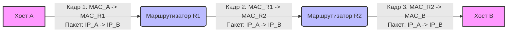

На уровне канального доступа (L2) коммутация обеспечивает доставку кадров внутри одного широковещательного домена на основе физических MAC-адресов. Однако реальные сети состоят из множества таких доменов, объединенных в единую инфраструктуру. Для доставки данных между разными сетями используется сетевой уровень (L3), а ключевым устройством здесь выступает маршрутизатор.

## IP-адрес и логическая адресация

IP-адрес — это логический идентификатор, назначаемый сетевому интерфейсу устройства для его участия в обмене данными на сетевом уровне. В отличие от MAC-адреса, который является физическим, «вшитым» в оборудование и имеет плоскую структуру (не несет информации о местоположении в сети), IP-адрес имеет иерархическую структуру.

Иерархичность означает, что IP-адрес делится на две части: адрес сети и адрес хоста. Адрес сети идентифицирует конкретный сегмент (подсеть) в глобальной или корпоративной топологии, а адрес хоста уникально идентифицирует устройство внутри этого сегмента. Именно эта иерархия позволяет маршрутизаторам агрегировать информацию о путях и не хранить данные о каждом отдельном устройстве в мире, оперируя целыми сетями.

## Маска подсети и понятие подсети

Маска подсети — это 32-битное число (для IPv4), которое определяет, какая часть IP-адреса относится к сети, а какая — к хосту. Маска состоит из непрерывной последовательности единиц, за которой следуют нули.

Принцип работы маски основан на побитовой логической операции И (AND). Когда IP-адрес накладывается на маску подсети, биты хостовой части обнуляются, и результатом становится сетевой адрес. Например, для адреса `192.168.1.10` с маской `255.255.255.0` (или `/24`) сетевым адресом будет `192.168.1.0`.

> [!info] Сетевой и широковещательный адреса
> В любой подсети два адреса зарезервированы и не могут быть назначены хостам. Первый адрес (все биты хоста равны 0) идентифицирует саму сеть. Последний адрес (все биты хоста равны 1) является адресом ограниченного широковещания (broadcast) для данной подсети. Допустим есть маска 192.168.1.0/255.255.255.0
> - Всего адресов: **256** (от `192.168.1.0` до `192.168.1.255`).
> - **Служебные адреса:**
>    - `192.168.1.0` — адрес сети (служебный). Он определяет саму подсеть и используется маршрутизаторами для направления трафика.
 >   - `192.168.1.255` — широковещательный адрес (служебный). Он используется для отправки пакетов сразу всем устройствам внутри этой подсети

- **Доступные для устройств (хостов):** **254** адреса (в диапазоне от `192.168.1.1` до `192.168.1.254`)

Таблица соответствий:

![[images 1.jpg]]

## Пакет и кадр: инкапсуляция и путешествие данных

Для понимания маршрутизации критически важно разграничивать понятия кадра (frame) и пакета (packet). Кадр — это единица данных канального уровня (L2), содержащая MAC-адреса источника и назначения, а также полезную нагрузку. Пакет — это единица данных сетевого уровня (L3), содержащая IP-адреса источника и назначения.

Как показано на схеме, IP-адреса источника и назначения в заголовке пакета **не изменяются** на всем пути от отправителя к получателю (за исключением редких случаев использования NAT, который выходит за рамки базовой маршрутизации). В то же время MAC-адреса в заголовке кадра **изменяются на каждом переходе (hop)**. Маршрутизатор распаковывает кадр, извлекает пакет, принимает решение о маршруте, а затем инкапсулирует этот же пакет в новый кадр с новыми MAC-адресами для следующего сегмента сети.

## Шлюз по умолчанию и прямое/непрямое подключение

Когда хост готовит пакет к отправке, он сравнивает свой IP-адрес и маску подсети с IP-адресом назначения.

Если сетевые адреса совпадают, происходит **прямая доставка**. Хост понимает, что получатель находится в том же широковещательном домене. Для отправки кадра хосту необходимо знать MAC-адрес получателя, который он запрашивает с помощью протокола ARP (Address Resolution Protocol).

Если сетевые адреса не совпадают, требуется **непрямая доставка**. Хост не может отправить кадр напрямую за пределы своего широковещательного домена. Вместо этого он направляет пакет на **шлюз по умолчанию** (default gateway) — IP-адрес интерфейса локального маршрутизатора. Хост использует ARP, чтобы узнать MAC-адрес этого шлюза и отправляет пакет на маршрутизатор для дальнейшей пересылки в другую подсеть.

>[!note] Роль ARP
>ARP является связующим звеном между L3 и L2. Маршрутизация оперирует IP-адресами, но физическая передача по Ethernet невозможна без MAC-адресов. ARP отвечает на вопрос: «Какой MAC-адрес соответствует данному IP-адресу в этом сегменте?».

## Таблица маршрутизации

Таблица маршрутизации — это «карта» сети, хранящаяся в оперативной памяти маршрутизатора. В отличие от таблицы MAC-адресов коммутатора, которая заполняется автоматически при изучении входящих кадров, таблица маршрутизации формируется на основе конфигурации администратора (статические маршруты) или информации, полученной от других маршрутизаторов (динамическая маршрутизация). Ее главная задача — ответить на вопрос: «Через какой интерфейс и какому следующему устройству нужно отправить пакет, чтобы он достиг сети назначения?».

Каждая запись в таблице содержит набор параметров, которые совместно определяют путь для трафика. Понимание этих полей необходимо для анализа того, как именно маршрутизатор принимает решения.

* **Сеть назначения (Destination Network)** определяет целевую подсеть или хост. Запись всегда включает сам IP-адрес сети и длину маски (префикса), например `192.168.10.0/24`. Это фильтр, с которым сравнивается адрес назначения в поступающем пакете.
* **Метрика (Metric)** представляет собой «стоимость» прохождения пути. Единицы измерения метрики зависят от конкретного протокола динамической маршрутизации: это может быть количество переходов (hops), пропускная способность канала, задержка или загрузка линии. Маршрутизатор всегда предпочтет путь с наименьшей метрикой.
* **Следующий переход (Next-hop)** — это IP-адрес интерфейса соседнего маршрутизатора, которому данный маршрутизатор должен передать пакет. Важно понимать, что Next-hop всегда должен находиться в сети, которая непосредственно подключена к исходящему интерфейсу нашего маршрутизатора. Мы не можем указать next-hop, до которого сами еще не знаем, как добраться.
* **Исходящий интерфейс (Outgoing Interface)** — это физический (например, GigabitEthernet0/1) или логический порт локального маршрутизатора, через который физически уйдет кадр с инкапсулированным пакетом.

Существует также специальная запись — **маршрут по умолчанию** (default route, default via), обозначаемый как `0.0.0.0/0`. Она действует как «последняя инстанция»: если для адреса назначения не найдено более специфичного совпадения, пакет будет отправлен на ip адрес маршрутизатора, указанный в этой записи.

## Алгоритм принятия решения о маршрутизации

Процесс обработки пакета маршрутизатором строго детерминирован и выполняется для каждого пакета независимо.

При поступлении кадра на интерфейс маршрутизатор сначала проверяет контрольную сумму кадра. Если она верна, заголовок L2 удаляется, и маршрутизатор анализирует заголовок IP-пакета, фокусируясь на поле Destination IP. Далее выполняется поиск по таблице маршрутизации.

Алгоритм ищет записи, сетевой адрес которых совпадает с адресом назначения пакета при применении маски подсети. Если найдено несколько совпадений, применяется правило **наибольшей длины префикса (Longest Prefix Match)**. Маршрут с наиболее длинной маской (наиболее специфичный) всегда имеет приоритет. Например, для пакета с адресом назначения `10.1.1.5` маршрут `10.1.1.0/24` будет выбран вместо `10.0.0.0/8`, даже если оба присутствуют в таблице.

После выбора маршрута маршрутизатор уменьшает значение поля TTL (Time to Live) в заголовке пакета на единицу. Если TTL достигает нуля, пакет уничтожается, а отправителю возвращается ICMP-сообщение «Time Exceeded», что предотвращает бесконечное циркулирование пакетов при наличии петель маршрутизации. Затем пакет инкапсулируется в новый кадр с MAC-адресом next-hop (разрешенным через ARP) и ставится в очередь на отправку через исходящий интерфейс.

Если подходящая запись в таблице маршрутизации не найдена (и отсутствует маршрут по умолчанию), пакет немедленно отбрасывается, а источнику отправляется ICMP-сообщение «Destination Unreachable».

## Статическая маршрутизация

Статическая маршрутизация предполагает ручное конфигурирование записей в таблице маршрутизации администратором. Маршрут жестко задает, куда отправлять трафик для конкретной сети назначения.

Этот подход применяется в небольших сетях, на граничных маршрутизаторах для задания маршрута по умолчанию (так называемый «шлюз в интернет»), или для создания резервных путей с высокой метрикой (плавающие статические маршруты).

К преимуществам статической маршрутизации относятся предсказуемость поведения сети, отсутствие накладных расходов на обмен служебным трафиком и повышенная безопасность (маршруты не могут быть изменены извне). Главным недостатком является отсутствие масштабируемости и адаптивности: при изменении топологии или отказе канала связи администратор должен вручную переконфигурировать устройства, иначе трафик будет теряться.

## Динамическая маршрутизация

Динамическая маршрутизация решает проблемы масштабируемости за счет автоматизации. Маршрутизаторы обмениваются информацией о доступных сетях друг с другом, используя специализированные протоколы динамической маршрутизации.

Общая концепция работы динамических протоколов включает несколько этапов. Сначала маршрутизаторы обнаруживают соседей с помощью периодических служебных сообщений (hello). Затем они обмениваются информацией о своих непосредственно подключенных сетях или о всей известной им топологии. На основе полученных данных каждый маршрутизатор независимо строит карту сети и вычисляет наилучшие пути до всех известных сетей, используя свой алгоритм и метрики.

Главное преимущество динамической маршрутизации — способность автоматически адаптироваться к изменениям топологии (отказ канала, добавление нового маршрутизатора) без вмешательства человека. Этот процесс сходимости (convergence) занимает время, в течение которого возможна временная потеря пакетов. Платой за автоматизацию являются затраты процессорного времени, памяти и пропускной способности канала на обмен служебной информацией.

## Дополнительные механизмы: TTL и фрагментация

Поле **TTL (Time to Live)** в заголовке IP-пакета изначально задается операционной системой отправителя (часто значением 64, 128 или 255). Как упоминалось выше, его основная функция — защита сети от пакетов, бесконечно циркулирующих из-за ошибок конфигурации (петель маршрутизации). Каждый маршрутизатор, обрабатывающий пакет, декрементирует TTL на 1.

**Фрагментация** возникает, когда размер IP-пакета превышает максимальный размер блока передачи (MTU) исходящего интерфейса маршрутизатора. В IPv4 маршрутизатор может разделить такой пакет на несколько фрагментов, каждый из которых получает свой заголовок с флагами фрагментации и смещением. На конечном хосте эти фрагменты собираются обратно в исходный пакет. Стоит отметить, что в современном IPv6 фрагментация на промежуточных узлах запрещена: она допускается только на стороне отправителя, что упрощает работу маршрутизаторов и ускоряет обработку пакетов.